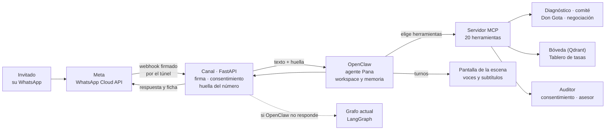
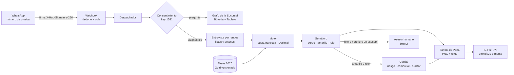
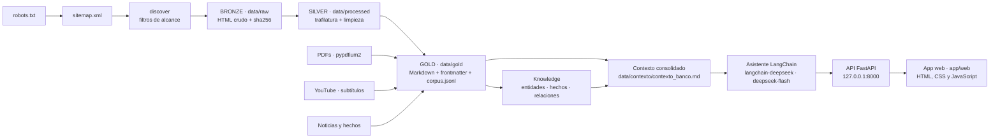
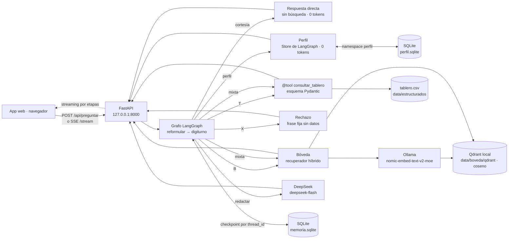

# Sucursal 1965 — Banco de Occidente

Pipeline **Medallion** (Bronze → Silver → Gold) del sitio público de **Banco de
Occidente** (`https://www.bancodeoccidente.com.co`), asistente que responde solo
con el corpus citando la fuente, y **Pana**, un corresponsal por WhatsApp que
orienta a jóvenes que van a pedir su primer crédito.

[](https://github.com/Darley843/Proyecto_BancoO/actions/workflows/ci.yml)


[](./LICENSE)

## Problema y solución

La información pública del banco está dispersa en ~200 páginas HTML, 190 PDFs y
32 videos, sin estructura común ni forma de citarla. Este proyecto la captura
respetando `robots.txt`, la limpia a un corpus Gold con frontmatter y consolida un
contexto único que alimenta un asistente LangChain con DeepSeek, con validación de
fuente y una app web local. El Módulo 1 usa el **contexto consolidado completo** en
el prompt de sistema; el Módulo 2 añade la Bóveda (fragmentos, Ollama/Qdrant y
recuperación híbrida), el Tablero de tarifas, el grafo con memoria y la app web de
la Sucursal 1965. La entrega final lleva todo eso a WhatsApp con **Pana**.

## Entrega final: Pana, el corresponsal por WhatsApp

**Para quién.** Jóvenes que van a pedir su primer crédito y no saben si la cuota
les cabe. Pana les responde con las tasas que publica el banco, les hace un
diagnóstico por rangos y les muestra con un semáforo si el crédito es sano. Es
una **orientación, no una aprobación**: la decisión final la toma el banco.

### Arquitectura de la entrega final



1. El invitado le escribe a Pana por WhatsApp. Meta entrega el mensaje al
   **canal** (FastAPI), que verifica la firma, pide el consentimiento de la Ley
   1581 y convierte el número en una **huella**: el número nunca sale del canal.
2. El canal le pasa el texto y la huella al **agente de Pana en OpenClaw**, por
   su API HTTP en `127.0.0.1` con token.
3. El agente decide con su workspace (identidad, reglas y límites) y usa las
   **herramientas del servidor MCP**, cada una con esquema Pydantic.
4. La respuesta vuelve por Meta. La pantalla muestra la escena en vivo y, al
   final, el invitado recibe la ficha de su opción: simulación orientativa,
   nunca «aprobado».
5. Si OpenClaw no responde, el canal contesta con el grafo actual.

Cómo desplegar todo, paso a paso: [`docs/DESPLIEGUE.md`](./docs/DESPLIEGUE.md).

### Las 20 herramientas

El detalle de cada herramienta —entrada Pydantic, salida, fuente de las cifras,
confirmación, módulo en el que delega y cuándo **no** usarla— está en
[`docs/HERRAMIENTAS.md`](./docs/HERRAMIENTAS.md), que se regenera con
`make herramientas-doc`. Ahí también está el control de la alucinación probado
contra el gateway real y las herramientas del gateway que Pana tiene bloqueadas.

| # | Herramienta | Qué hace | Sale de | Responsable | Confirmación |
|---|---|---|---|---|---|
| 1 | `consultar_tasa` | Rango de tasas con vigencia y fuente | Tablero de tasas | Nayla | — |
| 2 | `simular_cuota` | Cuota orientativa de un crédito | Motor del diagnóstico | Nayla | — |
| 3 | `verificar_usura` | Compara una tasa con la usura vigente | `config/tasas.toml` | Nayla | — |
| 4 | `diagnosticar_capacidad` | Semáforo de capacidad de pago | Motor del diagnóstico | Nayla | — |
| 5 | `comparar_escenario` | «¿Y si…?» con otro plazo o monto | `diagnostico/escenarios.py` | Nayla | — |
| 6 | `convocar_comite` | Riesgo, comercial y auditor | `diagnostico/comite.py` | Nayla | — |
| 7 | `calcular_prestamo_gota` | Lo que cobra Don Gota | `escena/gota.py` | Nayla | — |
| 8 | `comparar_gota_banco` | Gota a gota frente al banco y la usura | `escena/comparacion.py` | Nayla | — |
| 9 | `negociar_opcion` | Negociación entre los dos agentes | `escena/negociacion.py` | Nayla | — |
| 10 | `generar_ficha_opcion` | Ficha de la opción para WhatsApp | Nueva | Nayla | — |
| 11 | `responder_sobre_proyecto` | Preguntas del público sobre el proyecto | `escena/pregunta.py` | Nayla | — |
| 12 | `registrar_consentimiento` | Aviso y aceptación de la Ley 1581 | `canal/consentimiento.py` | Darley | — |
| 13 | `olvidar_mis_datos` | Borra los datos de la persona | Revocación | Darley | **Sí** |
| 14 | `solicitar_asesor` | Abre un caso con un asesor humano | HITL | Darley | **Sí** |
| 15 | `consultar_caso` | Estado del caso con el asesor | HITL | Darley | — |
| 16 | `generar_tarjeta_pana` | Tarjeta del resultado (PNG + texto) | `pana/` | Darley | — |
| 17 | `buscar_en_documentos` | Respuesta con documento y fragmento citados | Bóveda | Anny | — |
| 18 | `consultar_tarifas` | Tarifas y comisiones | Tablero | Anny | — |
| 19 | `clasificar_pregunta` | Digiturno y filtro de dominio | `sucursal/digiturno.py` | Anny | — |
| 20 | `auditar_respuesta` | Cifras con fuente, sin promesas ni datos personales | Auditor | Anny | — |

Las veinte corren en el servidor MCP `sucursal`, por HTTP en
`127.0.0.1:8765/mcp`, y el gateway de OpenClaw solo ve esas veinte:

```bash
make agente-mcp      # servidor MCP con las 20 herramientas
make herramientas    # lista las 20 y sus esquemas Pydantic
make traza           # últimas llamadas, sin textos libres ni datos personales
```

Cada llamada queda en la traza local (`data/asistente/trazas/herramientas.jsonl`,
sin versionar). La pantalla de la escena la muestra en vivo con la tecla **H**
(`GET /api/herramientas/traza`: nombre, resultado y latencia, sin argumentos).
El servidor de solo lectura por stdio de la fase 2 (`consultar_tasa`,
`simular_cuota`, `buscar_en_boveda`) sigue disponible para OpenCode
([`docs/MCP.md`](./docs/MCP.md)).

### Dentro del canal

El canal ya hace el recorrido completo sin OpenClaw; es el respaldo y la base
de las herramientas:



| Pieza | Qué hace | Dónde | Documento |
|---|---|---|---|
| Canal | Recibe y responde por WhatsApp Cloud API: firma, deduplicación, cola, huella del número (nunca el número en claro) | `canal/` | [`OPERACION_WHATSAPP.md`](./docs/OPERACION_WHATSAPP.md) |
| Consentimiento | Aviso de la Ley 1581, «Acepto» y «olvida mis datos» con borrado | `canal/consentimiento.py` | [`SEGURIDAD.md`](./docs/SEGURIDAD.md) |
| Tasas 2026 | Lee el PDF de tasas del banco a una tabla Gold con vigencia, fuente y `sha256`, y la valida contra la usura | `tablero/tasas.py` | [`DIAGNOSTICO.md`](./docs/DIAGNOSTICO.md) |
| Diagnóstico | Entrevista por rangos, motor determinista y semáforo con umbrales en `config/diagnostico.toml` | `diagnostico/` | [`DIAGNOSTICO.md`](./docs/DIAGNOSTICO.md) |
| Comité | Tres miradas (riesgo, comercial, auditor) en una sola ronda para casos amarillos y rojos | `diagnostico/comite.py` | [`COMITE.md`](./docs/COMITE.md) |
| Pana y tarjetas | El personaje y la tarjeta del resultado (PNG + texto equivalente) | `pana/` | — |
| «¿Y si…?» | Compara otro plazo o monto sin tocar el diagnóstico original | `diagnostico/escenarios.py` | [`DIAGNOSTICO.md`](./docs/DIAGNOSTICO.md) |
| MCP | Servidor `sucursal` con las 20 herramientas en `127.0.0.1:8765` (`make agente-mcp`) y el de solo lectura por stdio para OpenCode | `mcp_servidor/` | [`MCP.md`](./docs/MCP.md) |
| Agente pana | Veinte herramientas Pydantic sobre el Tablero, el motor, la escena y la Bóveda, con traza local y confirmación en dos pasos | `herramientas/`, `openclaw/` | [`AGENTE_OPENCLAW.md`](./docs/AGENTE_OPENCLAW.md) |
| Roba la Bóveda | Juego de ataque: inyección, extracción del prompt, datos personales y fuera de tema | `roba/` | [`ROBA_BOVEDA.md`](./docs/ROBA_BOVEDA.md) |
| Operación y latencia | Vista con mensajes, consentimientos, casos y p50/p95 real por flujo | `arqueo/latencia.py`, `app/web/vistas/operacion.js` | [`ARQUEO.md`](./docs/ARQUEO.md) |
| Simulador | Personas sintéticas que recorren el canal con el enviador falso | `simulador/` | — |

**Probar sin WhatsApp ni claves:**

```bash
make simular     # recorre el canal con las personas sintéticas (sin red)
make app         # app web: Operación y Roba la Bóveda incluidas
make arqueo      # métricas: recuperación, filtro de dominio y latencia
```

Para conectar el número de prueba de Meta, sigue la sección
[Canal de WhatsApp](#canal-de-whatsapp) y [`docs/LISTA_DEMO.md`](./docs/LISTA_DEMO.md).
Si algo falla en la sustentación, el plan B y las capturas de respaldo están en
[`docs/CONTINGENCIA.md`](./docs/CONTINGENCIA.md).

### La presentación: «Pana vs. el gota a gota»

La sustentación final (sábado 28 de noviembre de 2026) no usa diapositivas:
invitados de empresas le escriben a Pana desde su teléfono y **los agentes se
presentan solos**, en vivo, con voz y subtítulos. Una persona del público inventa
un personaje y responde cuatro preguntas; **Don Gota** le ofrece plata al 20 %
mensual; Pana compara en tasa efectiva anual con la usura como referencia; el
agente del joven y la agente del banco negocian; y el **auditor** revisa las
cifras y da el veredicto. Si sale rojo, Pana sugiere alternativas formales, nunca
el gota a gota.

| Regla | Por qué |
|---|---|
| El voluntario inventa su personaje | Nunca datos reales |
| Don Gota sale del código, nunca de un modelo | Sus cifras son fijas y verificables |
| Cada cifra lleva su fuente (motor, simulador o Tablero) | El auditor la revisa antes de decirla |
| Subtítulos siempre visibles | Si la voz falla, la escena sigue con clics |

Cada personaje habla con una voz distinta, generada en el computador con Piper:

```bash
make voz-modelo     # una vez: baja las voces que nombra config/voz.toml
make voces-prueba   # una muestra .ogg por personaje en data/modelos/voz/muestras/
```

Con `make app` abierto, `http://127.0.0.1:8000/voces.html` permite escoger y
probar las voces. Detalle en [`docs/VOZ.md`](./docs/VOZ.md).

## Arquitectura



El grafo de la fase 2 decide la ruta antes de buscar y responde por SSE:



| Capa | Carpeta | Contenido | ¿Se versiona? |
|---|---|---|---|
| Bronze | `data/raw/` | HTML crudo, `urls.jsonl`, `capture.jsonl` con `sha256` | No |
| Silver | `data/processed/` | Markdown limpio, sin boilerplate | No |
| Gold | `data/gold/` | Markdown + frontmatter, `corpus.jsonl`, índices | **Sí** |
| Contexto | `data/contexto/` | Contexto consolidado y `manifest.json` | Sí |
| Knowledge | `data/knowledge/` | Entidades, hechos y relaciones con cita | Sí |

Gold es el entregable: de ahí se generan el contexto consolidado y el índice. Los
encabezados `##` son fronteras de *chunk* y los metadatos permiten citar el origen.

## Estado de la captura

| Métrica | Valor |
|---|---:|
| Documentos Gold | 241 (181 páginas web + 40 hechos + 20 noticias) |
| Tokens de las páginas Gold | 196.139 (promedio 813,9) |
| Documentos PDF y videos | 190 PDFs (10.954.933 tokens) · 32 videos (119.845 tokens) |
| Tokens del corpus completo | 11.270.917 |
| Contexto consolidado | 166.647 de 175.000 tokens (191 páginas incluidas, 50 excluidas) |
| Capa Knowledge | 2 entidades, 6 hechos, 1 relación (semilla validada) |
| Cobertura del checklist | 24/24 (heurística) |

Bronze y Silver no se versionan. En el checkout de Git solo se conserva **1 HTML**
de Bronze y Silver está vacío, así que un clon limpio **no puede regenerar** las
181 páginas web sin volver a capturar (`make all`; ver `CONSTITUTION.md` §14). El
repositorio versiona Gold, el contexto y los resultados de evaluación. Fuente:
`data/gold/_INDICE.md`, `corpus.jsonl` y `data/contexto/manifest.json`.

### Diagramas interactivos de la fase 2 (Archify)

El recorrido **navegador → FastAPI → grafo → Bóveda/Tablero → SQLite**, con
Ollama local y DeepSeek como servicio externo, vive en
[`docs/arquitectura.html`](./docs/arquitectura.html). Su fuente tipada es
`docs/arquitectura.json`; el HTML se genera, nunca se edita a mano.

El flujo de datos - **Gold → chunks → fragmentos → Ollama → Qdrant →
recuperación → respuesta citada**, y **PDF/tablas → CSV → plantilla** - vive en
[`docs/datos.html`](./docs/datos.html). Su fuente es `docs/datos.json` y también
se genera con Archify.

El turno del canal - **Meta → webhook → despachador → entrevista o grafo →
Bóveda → EnviadorMeta** - vive en [`docs/canal.html`](./docs/canal.html), con su
fuente `docs/canal.json`. Y la entrevista del diagnóstico, del aviso de la Ley
1581 al semáforo y la tarjeta, vive en
[`docs/diagnostico.html`](./docs/diagnostico.html), con `docs/diagnostico.json`.

```bash
# una vez: instala Archify v3.2.0 en el commit auditado (Node >= 18).
# No uses `skills@latest`: actualizar exige repetir la auditoría
# (docs/auditoria-skills-proyecto.md).
tmp="$(mktemp -d)"
git init -q "$tmp"
git -C "$tmp" fetch -q --depth 1 https://github.com/tt-a1i/archify.git a4065941f12be7967436261d9934784e381d423c
git -C "$tmp" checkout -q FETCH_HEAD
rm -rf ~/.agents/skills/archify
mkdir -p ~/.agents/skills
cp -r "$tmp/archify" ~/.agents/skills/archify
rm -rf "$tmp"

# cada vez que cambie un diagrama
node ~/.agents/skills/archify/bin/archify.mjs finalize architecture \
  docs/arquitectura.json docs/arquitectura.html --repo-root . --quality showcase --json
node ~/.agents/skills/archify/bin/archify.mjs finalize dataflow \
  docs/datos.json docs/datos.html --repo-root . --quality showcase --json
node ~/.agents/skills/archify/bin/archify.mjs finalize sequence \
  docs/canal.json docs/canal.html --repo-root . --quality showcase --json
node ~/.agents/skills/archify/bin/archify.mjs finalize workflow \
  docs/diagnostico.json docs/diagnostico.html --repo-root . --quality showcase --json
```

En PowerShell, la instalación equivalente es la que se probó en Windows:

```powershell
$tmp = Join-Path $env:TEMP "archify-src"
git init -q $tmp
git -C $tmp fetch -q --depth 1 https://github.com/tt-a1i/archify.git a4065941f12be7967436261d9934784e381d423c
git -C $tmp checkout -q FETCH_HEAD
Remove-Item -Recurse -Force "$HOME\.agents\skills\archify" -ErrorAction SilentlyContinue
New-Item -ItemType Directory -Force "$HOME\.agents\skills" | Out-Null
Copy-Item -Recurse "$tmp\archify" "$HOME\.agents\skills\archify"
Remove-Item -Recurse -Force $tmp
```

La skill instalada debe tener 206 archivos, como en la auditoría.

En PowerShell el CLI queda en `$HOME\.agents\skills\archify\bin\archify.mjs`. La
corrida deja los recibos `docs/arquitectura.finalize*.json`,
`docs/arquitectura.browser-check.json` y los equivalentes `docs/datos.*.json`,
`docs/canal.*.json` y `docs/diagnostico.*.json`; si algún gate falla, se corrige
el JSON y se repite el comando completo.

## Requisitos e instalación

- Python 3.13 (uv lo instala si falta) y [uv](https://docs.astral.sh/uv/)
- GNU Make 4.x para los atajos (el CLI funciona sin `make`)
- `DEEPSEEK_API_KEY` solo para la app y la evaluación
- [Ollama](https://ollama.com/) con `nomic-embed-text-v2-moe` para la Bóveda
  (`ollama pull nomic-embed-text-v2-moe`); no necesita clave ni genera costo

El sitio está detrás de CloudFront y puede responder `403` a tráfico de VPN o
datacenter. Es una limitación documentada (`CONSTITUTION.md` §10): el pipeline se
detiene y la reporta, sin cambiar User-Agent, proxies ni red para sortear el WAF.

```bash
git clone https://github.com/Darley843/Proyecto_BancoO.git
cd Proyecto_BancoO
uv sync --all-extras
```

La clave del modelo se pasa por variable de entorno, sin archivos `.env`:

```powershell
# PowerShell
$env:DEEPSEEK_API_KEY = "<tu-clave>"
```

```bash
# bash / zsh
export DEEPSEEK_API_KEY="<tu-clave>"
```

Los comandos del corpus no necesitan la clave; solo la app y `make evaluar`.

## Uso

### Sucursal 1965 (app web de la fase 2)

```bash
make app            # o: uv run python app.py
```

Abre `http://127.0.0.1:8000`. `app.py` levanta FastAPI con uvicorn solo en
`127.0.0.1` y sirve la app web de `app/web/`, hecha con HTML, CSS y JavaScript
propios: sin frameworks, sin Node y sin paso de compilación.

| Ruta | Qué es |
|---|---|
| `app/web/index.html` | Armazón: encabezado, saldo del día y navegación de la sucursal |
| `app/web/estilos.css` | Identidad visual (colores como variables, modo oscuro, celular) |
| `app/web/app.js` | Cambia de vista y decide si usa la API o los datos de ejemplo |
| `app/web/comun.js` | Utilidades de presentación que comparten `app.js` y las vistas |
| `app/web/vistas/` | Una vista por archivo: `vestibulo`, `ventanilla`, `boveda`, `tablero`, `camara`, `arqueo`, `operacion`, `roba`; cada una exporta `render(contenedor, estado)` |
| `app/web/datos-ejemplo/` | Un JSON por endpoint, con la misma forma que la API (`estado`, `preguntar`, `tablero`, `mapa`, `pipeline`, `arqueo`, `vestibulo`, `operacion`, `roba`) |
| `app/web/voz.js` · `voces.html` | Voces de la escena y su probador |

**Maqueta frente a API.** Al abrir, `app.js` pide `/api/estado`. Si la API
responde, todas las vistas usan la API; si no, usan `app/web/datos-ejemplo/`
y el encabezado muestra el sello «Datos de ejemplo». Con `?ejemplo=1` en la
URL se fuerza la maqueta aunque la API esté encendida. Para revisar solo el
diseño, sin FastAPI ni claves:

```bash
uv run python -m http.server 8001 --directory app/web   # http://localhost:8001
```

### Pipeline y evaluación

```bash
uv run corpus all                        # discover -> fetch -> extract -> gold -> stats
uv run corpus docs all                   # PDFs (balances, informes)
uv run corpus videos all                 # canal de YouTube
uv run python -m banco_occidente_corpus.contexto   # contexto consolidado
make check                               # ruff + ty + pytest
make evaluar                             # 20 preguntas (requiere DEEPSEEK_API_KEY)
```

`make help` lista todos los atajos (`init`, `doctor`, `demo`, `health`, `deliver`, `clean`).

### Bóveda: fragmentos, índice y recuperación

La fase 2 deja de enviar el corpus completo al modelo: construye fragmentos,
los vectoriza con Ollama y recupera por similitud y por términos.

```bash
ollama pull nomic-embed-text-v2-moe     # una sola vez
make fragmentos                          # data/boveda/fragmentos_base.jsonl (sin red)
make indice                              # indexa web + PDF de producto + hechos
make indice-completo                     # añade el resto de PDF y los videos
make migrar-qdrant                       # copia un índice Chroma existente a Qdrant (compatibilidad)
```

| Pieza | Dónde | Qué hace |
|---|---|---|
| Fragmentos | `boveda/fragmentos.py` | Fusiona chunks hasta 80 tokens, limita a 400 y parte tablas largas por filas |
| Embeddings | `boveda/embeddings.py` | `nomic-embed-text-v2-moe` con `base_url` explícito y prefijos de tarea |
| Índice | `boveda/almacen.py` | Qdrant local en `data/boveda/qdrant`, colección `boveda` y coseno; Chroma queda solo como compatibilidad con `[almacen] tipo` |
| Recuperación | `boveda/recuperador.py` | Híbrido vectorial + BM25 con pesos de `config/sucursal.toml` |
| Mapa | `boveda/mapa.py` | PCA 2D de los vectores, normalizado de 0 a 100; se regenera en `make indice` |

El índice **no se versiona**: se regenera con `make indice`. La configuración
vive en `config/sucursal.toml` (`[embeddings]` y `[recuperacion]`); los
embeddings no usan `DEEPSEEK_API_KEY` ni aparecen en el consumo de DeepSeek.

### Digiturno

Antes de recuperar o consultar el Tablero, cada pregunta recibe un turno con una
letra:

| Letra | Ruta |
|---|---|
| `B` | Bóveda: consulta general |
| `B` · motivo `cortesia` | Cortesía: saludo, gracias o identidad, sin recuperador ni modelo (0 tokens) |
| `T` | Tablero: tarifas, tasas de interés, cuotas, coberturas o carencias |
| `T` · motivo `mixta` | Mixta: la cifra del Tablero y la explicación de la Bóveda en el mismo turno |
| `D` | Diagnóstico: capacidad de pago o de endeudamiento, «¿me alcanza?» o pedir el diagnóstico; invitación fija al diagnóstico guiado, sin recuperador ni modelo (0 tokens) |
| `X` | Rechazo: datos personales, fuera de alcance o una instrucción incrustada para cambiar o revelar las reglas |

Las reglas van antes que el modelo (PII → fuera de alcance → diagnóstico →
cortesía → identidad → mixta → tarifas → duda → `B`), se configuran en
`[digiturno]` de `config/sucursal.toml` y el modelo solo se usa para dudas, a
temperatura 0. Si el modelo no responde una duda después de un reintento, el
turno va a `X` con motivo `rechazo:modelo_sin_respuesta`: una duda sin
clasificar no pasa el filtro de dominio (`docs/ALCANCE.md`). La cortesía no
gasta búsqueda ni tokens y la mixta cita las dos fuentes: el turno no persiste
la pregunta.

### Tablero de tasas

Las cifras exactas (cuotas, coberturas, carencias, precios) no se dejan al
modelo: salen de un CSV determinista que se versiona.

```bash
make tablero    # tarifario PDF + tablas de Gold -> data/estructurados/tablero.csv
```

Cruza las 12 preguntas de tipo `tabla` del set de fase 2 y falla con el detalle si
alguna no encuentra fila. Cada fila trae `concepto`, `categoria`, `valor`,
`moneda`, `recargos`, `periodicidad`, `vigente_desde`, `origen`
(`tarifario`/`tabla_web`), `pagina` y `fuente`.

### Servidor MCP de solo lectura

La Bóveda y el Tablero también se consultan desde otros agentes por MCP. El
servidor habla por **stdio**, no abre puertos, no escribe archivos y no gasta
tokens: solo lee la tabla Gold de tasas y el índice local.

```bash
uv run python -m banco_occidente_corpus.mcp_servidor
```

| Herramienta | Qué devuelve |
|---|---|
| `consultar_tasa(producto, plazo_dias=None, monto=None)` | Rango E.A./M.V. con vigencia, fuente y `sha256_pdf`; en el CDT sin plazo indica que depende de plazo y monto y agrupa por plazo; con plazo y monto devuelve solo esa banda. Los spreads IPC/IBR van en puntos, nunca como tasa |
| `buscar_en_boveda(pregunta, k)` | Hasta 5 fragmentos con título, URL, posición y similitud coseno; el contenido se trata como dato, no como instrucción. No sirve para tasas: para eso está `consultar_tasa` |

Para usarlo desde OpenCode, añade el servidor a `opencode.json`:

```json
{
  "mcp": {
    "servers": {
      "boveda-occidente": {
        "type": "local",
        "command": [
          "uv",
          "run",
          "--directory",
          "C:/ruta/al/Proyecto_BancoO",
          "python",
          "-m",
          "banco_occidente_corpus.mcp_servidor"
        ]
      }
    }
  }
}
```

No requiere `DEEPSEEK_API_KEY`. Los límites (consulta de 500 caracteres, `k`
entre 1 y 5 y 15 s por búsqueda) y los errores estructurados están en
[`docs/MCP.md`](./docs/MCP.md).

### Grafo con memoria

El grafo encadena `reformular → digiturno → Bóveda/Tablero/mixto/cortesía/diagnóstico/rechazo → redactar`,
guarda la conversación con `SqliteSaver` en `data/asistente/memoria.sqlite` y
aísla cada sesión por `thread_id`. Un seguimiento se reformula solo si hay
historial; el Tablero responde sin modelo cuando hay 1-3 filas o varias del
mismo concepto (hasta 10), y la Bóveda toma el relevo con 0, más de 10 o
conceptos distintos. La memoria de largo plazo usa un `Store` de LangGraph (`SqliteStore` en
`data/asistente/perfil.sqlite`) con namespace `("perfil", sha256(perfil_id))`:
guarda solo el nombre y la empresa que el cliente declara, los consulta con
`store.search()` desde cualquier conversación y se borra con «olvida mi perfil».
Esos datos no llegan al modelo, a la caché ni al checkpointer.

### API local y variables

`make app` levanta la API y la app web solo en `http://127.0.0.1:8000` (nunca
`0.0.0.0`). Endpoints: `GET /health`, `/api/estado`, `POST /api/preguntar`,
`POST /api/preguntar/stream` (SSE con una etapa por nodo), `/api/tablero`,
`/api/boveda/mapa`, `/api/pipeline`, `/api/arqueo` y `/api/vestibulo`.

`GET /health` responde 200 cuando hay índice o se está en modo demo y 503 cuando
falta el índice; no llama a Ollama ni a DeepSeek y no publica claves ni rutas.
`Ctrl + C` cierra en pocos segundos aunque quede una ventana con el streaming
abierto: uvicorn espera como máximo 5 s por las conexiones y suelta el puerto.

| Variable | Para qué |
|---|---|
| `DEEPSEEK_API_KEY` | respuestas con el modelo; sin ella, el asistente no puede redactar |
| `OLLAMA_HOST` / `OLLAMA_BASE_URL` | respaldo de la URL de embeddings; lo normal es `config/sucursal.toml` |
| `SUCURSAL_DEMO=1` | modo demo: sin DeepSeek, costo cero y sin escritura de gasto |
| `SUCURSAL_TOPE_USD` | sobrescribe el tope diario de `[sucursal]` para la sesión |
| `LANGSMITH_TRACING`, `LANGSMITH_API_KEY`, `LANGSMITH_PROJECT` | trazas opcionales en LangSmith; apagadas por defecto |

El gasto (`data/asistente/gasto.sqlite`) y la caché
(`data/asistente/cache.sqlite`) no se versionan.

### Trazas con LangSmith (opcional)

LangSmith es el observador externo del grafo y del modelo: cada turno aparece
como una traza con los nodos, la recuperación y la llamada a DeepSeek. Está
**apagado por defecto** y el código no lo activa ni lee `.env`: se enciende solo
para la sesión, exportando las tres variables antes de `make app`.

```powershell
# encender solo esta sesión
$env:LANGSMITH_TRACING = "true"
$env:LANGSMITH_PROJECT = "sucursal-1965-demo"
$env:LANGSMITH_API_KEY = Read-Host "Clave de LangSmith"

# apagar al terminar
Remove-Item Env:LANGSMITH_TRACING, Env:LANGSMITH_PROJECT, Env:LANGSMITH_API_KEY
```

Con las trazas encendidas, la pregunta y los fragmentos salen del equipo hacia
LangSmith; `docs/SEGURIDAD.md` §5.1 explica el encendido, el apagado y las
pruebas que impiden activarlo sin querer.

### Preguntar

`POST /api/preguntar` recibe la pregunta y el hilo de la Ventanilla. El grafo, el
recuperador y el modelo se construyen en la primera pregunta del proceso, no al
importar `app.py`. El Digiturno decide la letra: `B` (Bóveda), `T` (Tablero con
plantilla), `D` (invitación al diagnóstico, ruta `diagnostico`) o `X`
(rechazo). El campo `ruta` distingue además `cortesia` (sin búsqueda ni
modelo), `mixta` (Tablero + Bóveda en el mismo turno) y `perfil` (memoria del
cliente); esas tres rutas van por motivo y no son letras.

```bash
curl -s http://127.0.0.1:8000/api/preguntar \
  -H "Content-Type: application/json" \
  -d '{"pregunta": "¿Cuál es la cuota de manejo de la tarjeta débito?", "thread_id": "ses-abc", "perfil_id": "perfil-demo"}'
```

Request:

```json
{
  "pregunta": "¿Cuál es la cuota de manejo de la tarjeta débito?",
  "thread_id": "ses-abc",
  "perfil_id": "perfil-demo"
}
```

`perfil_id` es opcional: identifica la memoria de largo plazo (nombre y empresa)
que la Ventanilla guarda en `localStorage`. Sin él, una pregunta de perfil
responde que la memoria no está activa; el resto de rutas funciona igual.

Response 200, con la misma forma que `app/web/datos-ejemplo/preguntar.json`:

```json
{
  "turno": "T",
  "turno_numero": 12,
  "ruta": "tablero",
  "motivo": "tarifas",
  "uso_modelo": false,
  "reformulada": null,
  "respuesta": "Según el Tablero de tarifas:\n- Cuota de manejo tarjeta débito: 16.700 COP (mensual), vigente desde 2025-11-20\n\nFuentes:\n- https://www.bancodeoccidente.com.co/documents/d/guest/tarifas-persona-1",
  "fuentes": [
    {
      "n": 1,
      "titulo": "Cuota de manejo tarjeta débito",
      "url": "https://www.bancodeoccidente.com.co/documents/d/guest/tarifas-persona-1",
      "seccion": "otros",
      "tipo": "pdf",
      "similitud": null
    }
  ],
  "tokens_entrada": 0,
  "tokens_salida": 0,
  "tokens_cache": 0,
  "costo_usd": 0.0,
  "tiempo_s": 0.03,
  "cache": false
}
```

- `reformulada` es `null` cuando el grafo no reformuló; en un seguimiento trae la
  pregunta autónoma.
- `fuentes` solo trae objetos en `B` y `T` (en `X` va vacía); `similitud` es `null`
  cuando la fuente viene del Tablero, que no tiene puntaje.
- Un acierto de caché devuelve `cache: true` con tokens y costo en cero, y aun así
  deja el turno en el hilo para el seguimiento siguiente.
- El turno cobra una sola vez el total de las tres llamadas al modelo (reformular,
  clasificar y redactar); `llamadas` refleja el número real de invocaciones.

Errores, siempre como `{"error": {"codigo", "mensaje"}}`:

| HTTP | `codigo` | Cuándo |
|---|---|---|
| 422 | `pregunta_vacia` | la pregunta llega vacía |
| 422 | `thread_id_ausente` | falta el hilo de la conversación |
| 429 | `tope_alcanzado` | el gasto del día llegó al tope y la ruta necesita modelo |
| 503 | `indice_no_listo` | falta `data/boveda/indice.json`; ejecuta `make indice` |
| 503 | `sin_clave` | falta `DEEPSEEK_API_KEY` fuera de demo; usa `SUCURSAL_DEMO=1` |

Con `SUCURSAL_DEMO=1` la Bóveda responde con el fragmento principal y su fuente,
marcado como demo, sin crear el modelo ni escribir gasto.

### Preguntar con streaming

`POST /api/preguntar/stream` recibe el mismo cuerpo y atiende el turno con el
mismo servicio (caché, tope, memoria y blindaje), pero responde
`text/event-stream` con el avance del grafo. La Ventanilla lo usa para mostrar
las etapas mientras espera y guarda el «Recorrido del turno» en el comprobante.

```bash
curl -sN http://127.0.0.1:8000/api/preguntar/stream \
  -H "Content-Type: application/json" \
  -d '{"pregunta": "¿En qué año se fundó el Banco de Occidente?", "thread_id": "ses-abc"}'
```

| Evento | Cuándo | `data` |
|---|---|---|
| `etapa` | cada nodo empieza (`en_curso`) y termina (`hecho`) | `{nodo, etapa, estado, texto, detalle}`; `etapa` es `reformulando`, `router`, `buscando` o `redactando` |
| `final` | el turno terminó | el mismo cuerpo de `POST /api/preguntar` |
| `error` | un nodo falló a mitad del turno | `{"error": {"codigo": "error_interno", "mensaje"}}` |

- Las etapas salen de `grafo.stream(stream_mode=["tasks", "values"])` y nunca
  llevan la pregunta, la respuesta ni el hilo. La respuesta solo llega en `final`,
  ya validada con sus citas: no se transmite texto que el blindaje no revisó.
- Los rechazos previos al grafo (422, 429 y 503 de la tabla anterior) responden
  con su estado HTTP y el JSON de siempre, sin abrir el streaming.
- Un acierto de caché no ejecuta nodos: llega solo el evento `final`.
- Si la conexión se corta, la Ventanilla muestra el error con «Reintentar» y el
  hilo se conserva. `POST /api/preguntar` sigue igual para la evaluación y las pruebas.

### Scraper de demostración

Capa delgada sobre el pipeline: descubre hasta 5 URLs con el índice de sitemaps
(`robots.txt` y filtros de `config/site.toml` incluidos), las captura con
`net.HttpClient` y ejecuta Bronze → Silver → Gold con el contrato oficial. No
tiene cliente HTTP ni formato propios.

```bash
uv run python scripts/scrape_empresa.py          # 5 páginas en .demo/scrape_empresa/
uv run scripts/scrape_empresa.py --limit 3      # la misma demo, sin `python`
uv run python scripts/scrape_empresa.py --out .demo/prueba --delay 2
```

La salida por defecto es `.demo/scrape_empresa/` (ignorada por Git) con las capas
`raw/`, `processed/` y `gold/`. `--out` rechaza cualquier ruta dentro de `data/`.
Al final imprime el resumen por etapa y la ruta de una página Gold generada. Ante
un `403` o `429` se detiene con un mensaje neutro, sin cambiar de red ni de
cliente.

## Canal de WhatsApp

La Sucursal atiende por WhatsApp Cloud API con webhook propio en el mismo
FastAPI (Vía 2, sin N8N). El canal:

1. Verifica la firma `X-Hub-Signature-256` de Meta.
2. Deduplica por `id_mensaje` y responde 200 de inmediato.
3. Convierte el número en `usuario_id = HMAC-SHA256(número, sal)`.
4. Exige el consentimiento de la Ley 1581 antes de invocar el grafo.
5. Entrega el turno al grafo con `thread_id = wa:<usuario_id>`.
6. Envía la respuesta con el enviador real (`graph.facebook.com`) o el falso.

Guía detallada y diagnóstico: [`docs/OPERACION_WHATSAPP.md`](docs/OPERACION_WHATSAPP.md).

### 1. Requisitos previos

- Cuenta de Facebook con correo y teléfono verificados y 2FA.
- App de Meta tipo Business, publicada.
- Producto WhatsApp con número de prueba.
- Los cinco números autorizados en Meta (los cuatro del grupo y el del profesor).
- `uv` funcionando en el repositorio y `cloudflared` instalado.

### 2. Crear la app y obtener credenciales (Meta, una vez)

1. `developers.facebook.com/apps` → **Create app** → caso de uso de WhatsApp.
2. Nombre, correo y portafolio comercial (`Sucursal 1965 UAO`).
3. **WhatsApp → Configurar → Paso 1. Pruébalo**. Anota:

| Dato | Dónde | ¿Secreto? |
|---|---|---|
| Número de prueba | Paso 1 | No |
| **Phone Number ID** | debajo del número | No |
| **WABA ID** | «Identificador de la cuenta de mensajes» | No |
| Token temporal | «Token de acceso» | Sí (24 h) |

4. **Configuración de la app → Básica → Clave secreta de la app** (App Secret).
5. Token permanente: **Business settings → Usuarios → Usuarios del sistema** →
   agregar `sucursal-1965-bot` → **Generar token** → app `Prueba1` → caducidad
   60 días → permisos `whatsapp_business_messaging` y
   `whatsapp_business_management`.
   Si dice «No hay permisos disponibles», asigna la app al usuario del sistema en
   **Activos asignados → Apps → Administrar app**.
6. Inventa el **Verify Token**: cadena **alfanumérica** (sin `ñ`, tildes,
   espacios ni signos), porque viaja en una URL.

### 3. Variables de entorno (PowerShell, fuera del repo)

Crea `whatsapp-env.ps1` un nivel arriba de `ProyectoAvance1`:

```powershell
$env:WHATSAPP_PHONE_NUMBER_ID = "<phone-number-id>"
$env:WHATSAPP_APP_SECRET      = "<app-secret>"
$env:WHATSAPP_VERIFY_TOKEN    = "<token-alfanumerico>"
$env:WHATSAPP_ACCESS_TOKEN    = "<token-permanente>"
$env:WHATSAPP_ID_SALT         = "<cadena-aleatoria-larga>"
$env:WHATSAPP_MODO            = "falso"
```

Cárgalo en cada ventana donde lo necesites:

```powershell
. "..\whatsapp-env.ps1"
```

Comprueba que las seis existen:

```powershell
@("WHATSAPP_APP_SECRET","WHATSAPP_VERIFY_TOKEN","WHATSAPP_PHONE_NUMBER_ID","WHATSAPP_ACCESS_TOKEN","WHATSAPP_ID_SALT") |
  ForEach-Object { "$_ = $([bool](Get-Item "env:$_" -ErrorAction SilentlyContinue))" }
```

`.env.example` lista los nombres; el proyecto **no** lee `.env`
(`docs/SEGURIDAD.md` §4). Los valores reales nunca se versionan.

### 4. Autorizar los números (Meta + configuración)

1. **WhatsApp → Paso 1 → Envío de mensaje → To → Manage phone number list**.
2. Agrega cada número en formato internacional y verifica el código que llega
   por WhatsApp. El límite del número de prueba es **5 destinatarios**.
3. Calcula la huella de cada número:

```powershell
uv run python -m banco_occidente_corpus.canal.identidad --huella "+57 300 123 4567"
```

4. Pega la huella en `config/whatsapp.toml`, reemplazando un marcador:

```toml
[autorizados]
huellas = [
  "aaaaaaaaaaaaaaaaaaaaaaaaaaaaaaaaaaaaaaaaaaaaaaaaaaaaaaaaaaaaaaaa",
  "0000000000000000000000000000000000000000000000000000000000000002",
  # ...
]
```

Sin huella, el número queda como no autorizado y el envío real se bloquea con
`ErrorEnvio: destino no autorizado`.

### 5. Publicar y suscribir la app (Meta, una vez)

1. **Publicar**: activa el interruptor **«Activo»** (App Mode: Live). En modo
   Desarrollo, Meta no entrega mensajes reales, solo los eventos del botón
   «Probar».
2. **Suscribir la WABA a la app**:

```powershell
$uri = "https://graph.facebook.com/v23.0/<WABA_ID>/subscribed_apps?access_token=$($env:WHATSAPP_ACCESS_TOKEN)"
Invoke-RestMethod $uri | ConvertTo-Json -Depth 5       # debe listar Prueba1
Invoke-RestMethod -Method Post $uri | ConvertTo-Json   # suscribe
```

### 6. Levantar la app (ventana 1)

```powershell
cd "D:\...\ProyectoAvance1"
. "..\whatsapp-env.ps1"
$env:WHATSAPP_MODO = "real"   # "falso" registra el envío sin salir a WhatsApp
make app
```

Debe quedar en `http://127.0.0.1:8000`. **No cierres esta ventana**: Meta debe
alcanzarla cuando registres el callback.

### 7. Montar el túnel (ventana 2)

```powershell
& "$HOME\cloudflared.exe" tunnel --url http://127.0.0.1:8000
```

Si no lo tienes instalado:

```powershell
winget install --id Cloudflare.cloudflared -e
# o
Invoke-WebRequest -Uri "https://github.com/cloudflare/cloudflared/releases/latest/download/cloudflared-windows-amd64.exe" -OutFile "$HOME\cloudflared.exe"
```

Copia la URL del recuadro:

```
https://algo-nuevo.trycloudflare.com
```

**No cierres esta ventana.** El túnel rápido cambia de URL en cada arranque; si
se reinicia, hay que actualizarla en Meta. ngrok ya no ofrece dominio estático
gratis.

> El túnel publica **solo** `/webhooks/whatsapp` y `/health`: cualquier otra
> ruta responde `404` cuando la petición llega por Cloudflare. El detalle y el
> residual están en [`docs/SEGURIDAD.md`](./docs/SEGURIDAD.md) §3.12.

### 8. Registrar el callback en Meta (navegador)

En `Prueba1` → **Webhooks** → objeto **`Whatsapp Business Account`** (no `User`):

| Campo de Meta | Qué pegar |
|---|---|
| **URL de devolución de llamada** | `https://algo-nuevo.trycloudflare.com/webhooks/whatsapp` |
| **Token de verificación** | el valor de `WHATSAPP_VERIFY_TOKEN` |
| **Campos del webhook** | activar **Suscribirse** en `messages` |

Pulsa **Verificar y guardar**. Meta hace un `GET` y en la ventana 1 aparece
`GET /webhooks/whatsapp ... 200 OK`.

> Guardar la URL no suscribe la cuenta: son dos pasos distintos (paso 5 y este).

### 9. Comprobar (ventana 3)

```powershell
cd "D:\...\ProyectoAvance1"
. "..\whatsapp-env.ps1"

curl.exe "http://127.0.0.1:8000/health"
curl.exe "http://127.0.0.1:8000/webhooks/whatsapp?hub.mode=subscribe&hub.verify_token=$env:WHATSAPP_VERIFY_TOKEN&hub.challenge=12345"
curl.exe "https://algo-nuevo.trycloudflare.com/health"
```

El segundo comando debe devolver `12345`.

### 10. Probar la conversación

Desde un número autorizado escribe `hola` al número de prueba:

1. `hola` → aviso de la Ley 1581 con **Acepto** y **Ahora no**.
2. **Acepto** → confirmación y consentimiento guardado.
3. Una pregunta del alcance → respuesta del grafo con sus fuentes.

Cada mensaje deja `POST /webhooks/whatsapp ... 200 OK` en la ventana 1.

El primer mensaje tarda unos segundos: ahí se construyen el índice, el
recuperador y el modelo; el `200` ya se respondió a Meta.

### 11. Diagnóstico

El texto no se guarda ni se registra: solo la huella y el estado.

```powershell
@'
import sqlite3
with sqlite3.connect("data/asistente/whatsapp.sqlite") as c:
    print(c.execute("SELECT estado, COUNT(*) FROM mensajes GROUP BY estado").fetchall())
    print("consentimientos:", c.execute("SELECT COUNT(*) FROM consentimientos").fetchone()[0])
    print("envios:", c.execute("SELECT COUNT(*) FROM envios").fetchone()[0])
'@ | uv run python -
```

| Estado | Significado |
|---|---|
| `recibido` | registrado y encolado |
| `procesando` | el trabajador lo tomó |
| `respondido` | la respuesta se entregó al enviador |
| `ignorado` | número no autorizado o duplicado |
| `error` | falló el grafo o el envío |

| Síntoma | Causa |
|---|---|
| Meta no verifica el callback | App o túnel apagados, URL sin `/webhooks/whatsapp` o token distinto |
| `GET` 503 | Falta `WHATSAPP_VERIFY_TOKEN` en la ventana de la app |
| «Invalid HTTP request received» | Token con `ñ`, espacios o signos |
| «Probar» genera `POST 200` pero los mensajes reales no | App en modo Desarrollo o WABA sin `subscribed_apps` |
| `POST` 401 | `WHATSAPP_APP_SECRET` distinto |
| `POST` 503 | Falta `WHATSAPP_APP_SECRET` |
| Un check gris | El número remitente no está autorizado en Meta |
| `ErrorEnvio: destino no autorizado` | Falta la huella en `config/whatsapp.toml` o cambió la sal |
| El bot no responde | `WHATSAPP_MODO=falso`, falta `WHATSAPP_ID_SALT` o no reiniciaste la app |

### 12. Modos y límites

- `WHATSAPP_MODO=falso`: el envío se registra en `envios` y no sale a Meta. Es
  el modo de la suite y de los ensayos.
- `WHATSAPP_MODO=real`: envía por la API de Meta y exige la huella autorizada.
- Número de prueba: cinco destinatarios y ventana de 24 horas.
- La cola es en memoria: si reinicias la app, los pendientes se marcan `error`.
- Solo una persona puede tener el túnel activo para la misma app.

## Capturas

La app vigente es `app/web/` y se abre con `make app` en
`http://127.0.0.1:8000`. Sus ocho vistas son Vestíbulo, Ventanilla, Bóveda,
Tablero, Cámara, Arqueo, Operación y Roba la Bóveda. Las imágenes de `docs/capturas/` pertenecen a la app
Streamlit retirada en la fase 2 y se conservan solo como registro histórico; las
capturas vigentes deben tomarse de la app web.

## Resultados de la evaluación

`make evaluar` corre las 20 preguntas del alcance con el mismo flujo que la app:
prompt `qa_v1`, contexto completo y validación de fuente. La clasificación
automática solo ordena el trabajo; lo que se reporta es la revisión humana.

La revisión humana vive en `config/evaluacion/revision_humana.toml` (veredicto,
nota y revisor por pregunta), así que volver a correr la evaluación no la borra.
Una fila sin revisor, o con «propuesta» en el revisor, sale marcada como
propuesta pendiente de confirmar.

```bash
make evaluar SOLO=4,17        # repite solo esas preguntas y conserva las demás filas
make evaluar REVALIDAR=1      # sin API: revalida las respuestas guardadas y aplica la revisión
make evaluar VERSION=v2       # fase 2: 44 preguntas con el grafo -> docs/RESULTADOS_FASE2.md
```

La evaluación `VERSION=v2` responde con el grafo de la Sucursal (Bóveda, Tablero y
memoria por `thread_id`) en lugar del contexto completo, envía la pregunta previa
de cada seguimiento en el mismo hilo y escribe
`data/evaluacion/resultados_v2.jsonl` y
[`docs/RESULTADOS_FASE2.md`](./docs/RESULTADOS_FASE2.md) sin tocar los archivos de v1.

Resultados vigentes y respuestas completas de v1:
[`docs/RESULTADOS_20_PREGUNTAS.md`](./docs/RESULTADOS_20_PREGUNTAS.md).

## Estructura del repositorio

```text
├── app.py                     # arranque: FastAPI + app web en 127.0.0.1:8000 (make app)
├── app/
│   └── web/                   # Sucursal 1965: index.html, estilos.css, app.js, vistas/, datos-ejemplo/
├── src/banco_occidente_corpus/
│   ├── net.py · discover.py · fetch.py · extract.py · dedupe.py
│   ├── section.py · gold.py · checklist.py · stats.py · cli.py
│   ├── panel.py               # lectura de artefactos para la app (sin red)
│   ├── live_capture.py        # captura en vivo en carpeta temporal
│   ├── contexto.py · knowledge.py · documents.py · videos.py · news.py
│   ├── asistente/             # Q&A, FAQ, resumen y evaluación con DeepSeek
│   ├── boveda/               # fragmentos, embeddings, índice Qdrant y recuperador
│   ├── sucursal/             # digiturno (B/T/X/D), grafo, perfil y API de la fase 2
│   ├── canal/                # WhatsApp: webhook, identidad, consentimiento, HITL y envío
│   ├── diagnostico/          # entrevista guiada, motor, «¿Y si…?» y comité
│   ├── mcp_servidor/         # servidor MCP de solo lectura
│   ├── roba/                 # Roba la Bóveda: clasificador y marcador
│   ├── simulador/            # recorrido sintético del canal sin red
│   ├── pana/                 # personaje y tarjetas PNG del diagnóstico
│   └── tablero/              # tarifario y tablas de Gold → data/estructurados/tablero.csv
├── scripts/                   # demo_offline.py · scrape_empresa.py · tasks.py
├── config/ · data/ · docs/    # configuración, capas y documentación
├── config/sucursal.toml       # embeddings y recuperación de la fase 2
├── config/diagnostico.toml    # umbrales, límites y mapeo producto → objetivo
├── config/tasas.toml          # usura certificada y archivos del tarifario
├── config/whatsapp.toml       # canal: modo, aviso y huellas autorizadas (local)
├── test/                      # pytest con fixtures locales, sin red
├── makefile · pyproject.toml · uv.lock
└── CONSTITUTION.md · AGENTS.md
```

Las pruebas de la fase 2 también corren sin red: `test/test_canal_*.py`,
`test/test_diagnostico_*.py`, `test/test_mcp_servidor.py`,
`test/test_roba_*.py`, `test/test_simulador_*.py` y `test/test_web_roba.py`.
`make simular` recorre el canal completo con el enviador falso; el ensayo con
`WHATSAPP_MODO=real` es aparte y nunca forma parte de `make check`.

## Contrato de Gold

```yaml
---
fuente: https://www.bancodeoccidente.com.co/quienes-somos
titulo: Quiénes somos
seccion: identidad        # identidad | oferta | presencia | datos | atencion | legal
tokens: 812
hash: 3f9c1a7d
---
```

Un `.md` por URL con nombre estable, `corpus.jsonl` como fuente del índice y del
asistente, y `hash` para detectar cambios. Gold **nunca** se edita a mano: se
regenera con `make gold`. Contrato completo en [`CONSTITUTION.md`](./CONSTITUTION.md) §7.

## Knowledge, documentos y videos

- **Knowledge**: entidades, hechos y relaciones con cita obligatoria (`CONSTITUTION.md` §7).
- **Documentos y videos**: solo material público, prioridad por año y trazabilidad por hash.

## Noticias y hechos relevantes

`make noticias` genera fichas de prensa verificada y de la tabla «Información Relevante», y
no forma parte de `make all`, `make gold`, `make deliver`, `make docs`, `make docs-finanzas`,
`make videos` ni `make media`; la curaduría vive en `data/noticias/prensa.yaml`.

## Cómo contribuir

- Cada cambio va en una rama (`feat/`, `fix/`, `docs/`, `refactor/`, `test/`, `chore/`) y en un pull request que usa la plantilla [`.github/PULL_REQUEST_TEMPLATE.md`](./.github/PULL_REQUEST_TEMPLATE.md).
- Para que GitHub la cargue, abre el PR sin `--body`: `gh pr create --base main --title "..."` abre el editor con la plantilla para completarla.
- Los commits siguen Conventional Commits en español y GGA los revisa antes de cada commit.
- Cada PR necesita la aprobación de alguien distinto de quien subió el último commit.

## Documentación

[`CONSTITUTION.md`](./CONSTITUTION.md) (verdad central) · [`docs/ESTANDAR.md`](./docs/ESTANDAR.md)
(trazabilidad) · [`docs/FUENTES.md`](./docs/FUENTES.md) (fuentes y `robots.txt`) ·
[`docs/ALCANCE.md`](./docs/ALCANCE.md) (20 preguntas) ·
[`docs/MODELADO.md`](./docs/MODELADO.md) (Módulos 1 y 2) ·
[`docs/ARQUEO.md`](./docs/ARQUEO.md) (recuperación, evaluación y costo) ·
[`docs/RESULTADOS_FASE2.md`](./docs/RESULTADOS_FASE2.md) (44 preguntas de la fase 2) ·
[`docs/SEGURIDAD.md`](./docs/SEGURIDAD.md) (modelo de amenazas) ·
[`docs/MCP.md`](./docs/MCP.md) (servidor MCP de solo lectura) ·
[`docs/OPERACION_WHATSAPP.md`](./docs/OPERACION_WHATSAPP.md) (canal de WhatsApp) ·
[`docs/DIAGNOSTICO.md`](./docs/DIAGNOSTICO.md) (entrevista, motor y semáforo) ·
[`docs/COMITE.md`](./docs/COMITE.md) (comité de crédito) ·
[`docs/ROBA_BOVEDA.md`](./docs/ROBA_BOVEDA.md) (juego de ataque) ·
[`docs/EXPERIMENTO_LLAMADA.md`](./docs/EXPERIMENTO_LLAMADA.md) (llamada por WhatsApp, aplazada) ·
[`docs/LISTA_DEMO.md`](./docs/LISTA_DEMO.md) (lista del día de la demo) ·
[`docs/CONTINGENCIA.md`](./docs/CONTINGENCIA.md) (plan B y capturas de respaldo) ·
[`docs/VOZ.md`](./docs/VOZ.md) (voces de la escena) ·
[`AGENTS.md`](./AGENTS.md).

## Ética y legalidad

- `robots.txt` manda: lo que está en `Disallow` no se toca (`/portaltransaccional/`, `/icbs-web/`, `/AjaxTx`, `/wps/`).
- Ritmo de cortesía de 1,5 s entre peticiones (decisión del proyecto; `robots.txt`
  no declara `Crawl-delay`) y pausa de 10 s cada 50.
- User-Agent de navegador y header `From` con el contacto académico (`config/site.toml`).
- Solo información pública, sin zonas privadas, formularios ni datos personales
  (Ley 1581 de 2012); el HTML crudo se conserva para reprocesar sin molestar al sitio.

## Limitaciones y solución de problemas

- **Bloqueo del WAF (`403`)**: limitación documentada en `CONSTITUTION.md` §10.
  El pipeline se detiene e informa; no cambia el User-Agent, no usa proxies ni
  navegadores y no busca otra red para sortear el WAF.
- **`make` no existe en Windows**: `winget install ezwinports.make` o
  `choco install make`. También puede usarse `uv run corpus <comando>`.
- **Sin `DEEPSEEK_API_KEY`**: la app avisa y sigue en pie; el pipeline no la necesita.

## Licencia

[MIT](./LICENSE). El contenido del corpus pertenece a sus titulares y se usa con
fines académicos, citando la fuente en el frontmatter de cada documento. La
atribución de materiales de terceros está en [`NOTICE.md`](./NOTICE.md).

## Créditos

| Persona | Rol |
|---|---|
| Darley Idárraga | Líder de repositorio e integración |
| Yoldy Benavides | Ingeniería de datos |
| Nayla Ledesma | Método y memoria; asistente LangChain y app web |
| Anny Valencia | Seguridad y calidad |

Curso **TAAML**, Universidad Autónoma de Occidente (UAO).

## Referencias

- [uv](https://docs.astral.sh/uv/) · [trafilatura](https://trafilatura.readthedocs.io/)
- [RFC 9309 — robots.txt](https://www.rfc-editor.org/rfc/rfc9309) · [Sitemaps](https://www.sitemaps.org/protocol.html)
- [LangChain](https://python.langchain.com/) · [DeepSeek](https://api-docs.deepseek.com/)
