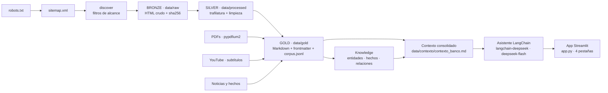
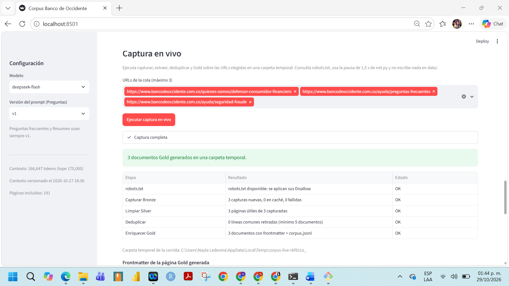
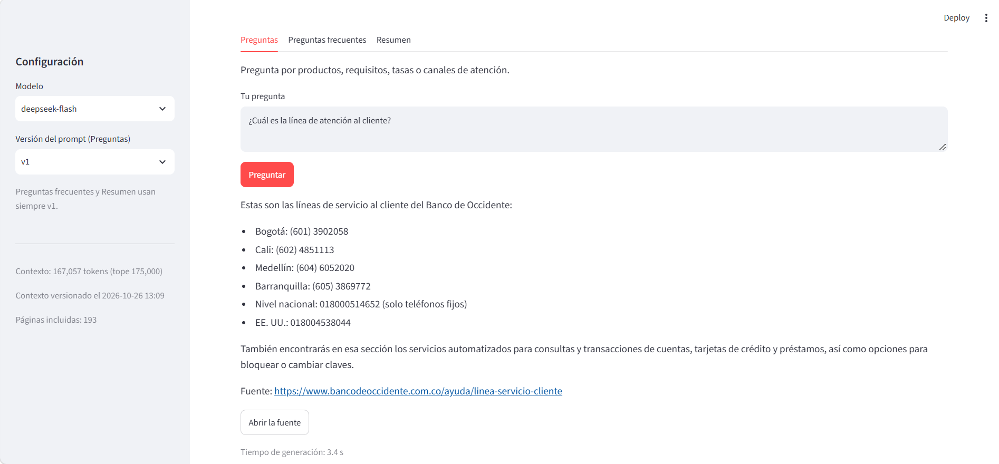
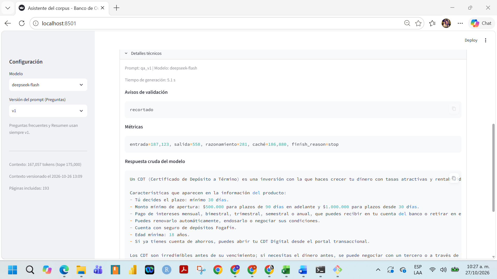
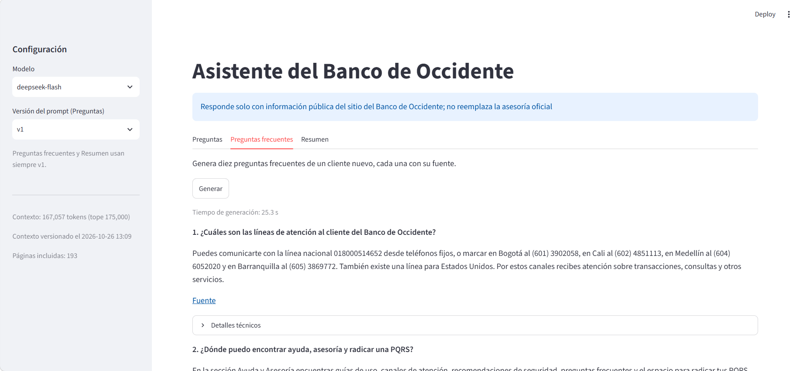
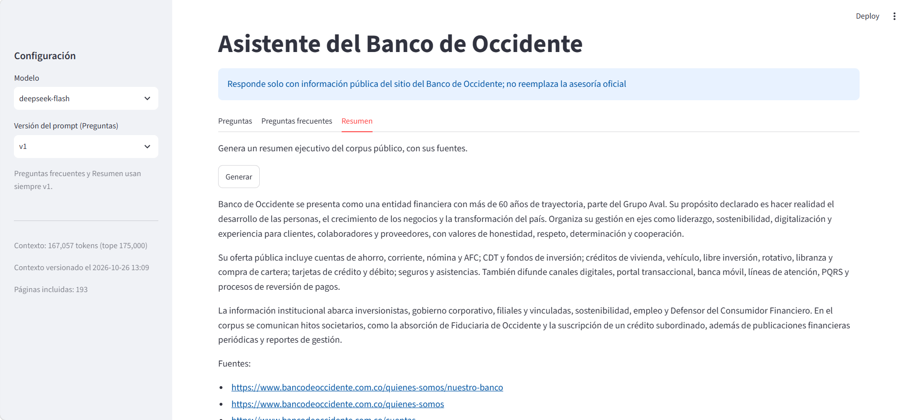
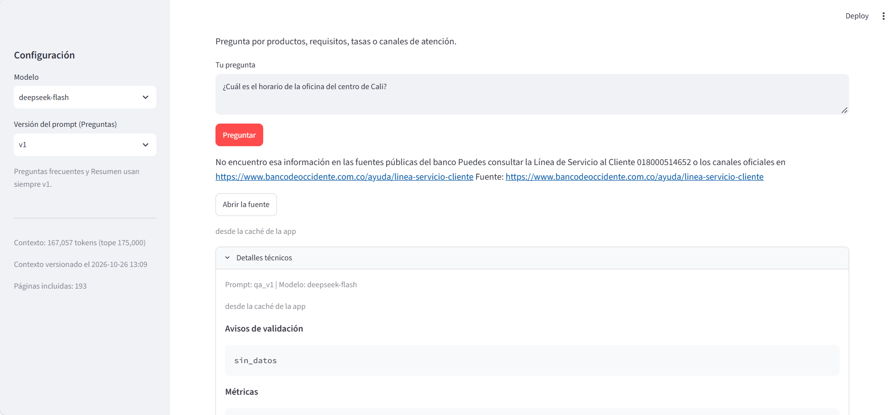
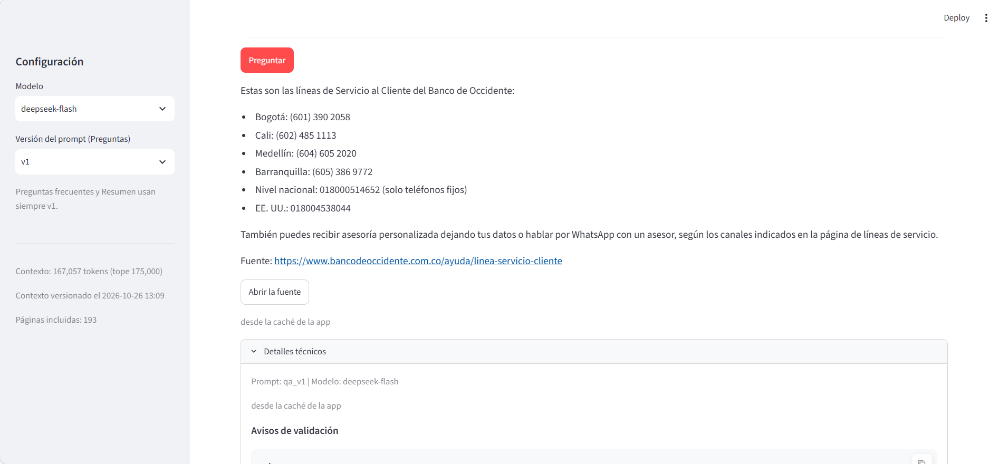
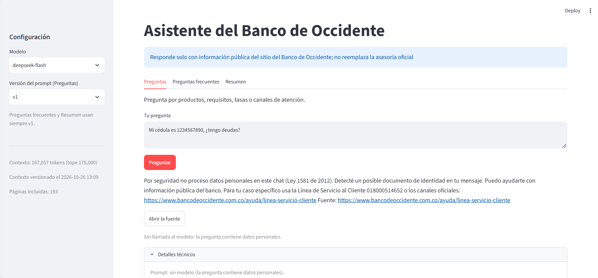
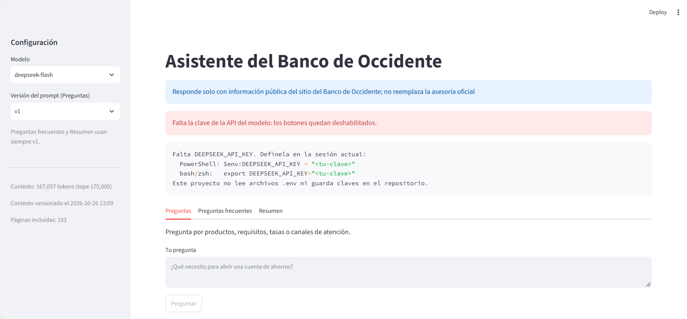

# Corpus web — Banco de Occidente

Pipeline **Medallion** (Bronze → Silver → Gold) del sitio público de **Banco de
Occidente** (`https://www.bancodeoccidente.com.co`) y asistente que responde solo
con el contexto consolidado del corpus, citando la fuente.

[](https://github.com/Darley843/Proyecto_BancoO/actions/workflows/ci.yml)


[](./LICENSE)

## Problema y solución

La información pública del banco está dispersa en ~200 páginas HTML, 190 PDFs y
32 videos, sin estructura común ni forma de citarla. Este proyecto la captura
respetando `robots.txt`, la limpia a un corpus Gold con frontmatter y consolida un
contexto único que alimenta un asistente LangChain con DeepSeek, con validación de
fuente y app Streamlit. Esta fase usa el **contexto consolidado completo** en el
prompt de sistema; la recuperación vectorial (RAG) es el Módulo 2.

## Arquitectura



| Capa | Carpeta | Contenido | ¿Se versiona? |
|---|---|---|---|
| Bronze | `data/raw/` | HTML crudo, `urls.jsonl`, `capture.jsonl` con `sha256` | No |
| Silver | `data/processed/` | Markdown limpio, sin boilerplate | No |
| Gold | `data/gold/` | Markdown + frontmatter, `corpus.jsonl`, índices | **Sí** |
| Contexto | `data/contexto/` | Contexto consolidado y `manifest.json` | Sí |
| Knowledge | `data/knowledge/` | Entidades, hechos y relaciones con cita | Sí |

Gold es el entregable: de ahí se generan el contexto consolidado y el índice. Los
encabezados `##` son fronteras de *chunk* y los metadatos permiten citar el origen.

## Estado de la captura

| Métrica | Valor |
|---|---:|
| Documentos Gold | 241 (181 páginas web + 40 hechos + 20 noticias) |
| Tokens de las páginas Gold | 196.139 (promedio 813,9) |
| Documentos PDF y videos | 190 PDFs (10.954.933 tokens) · 32 videos (119.845 tokens) |
| Tokens del corpus completo | 11.270.917 |
| Contexto consolidado | 166.647 de 175.000 tokens (191 páginas incluidas, 50 excluidas) |
| Capa Knowledge | 2 entidades, 6 hechos, 1 relación (semilla validada) |
| Cobertura del checklist | 24/24 (heurística) |

Bronze y Silver no se versionan: son capturas reproducibles que se reconstruyen
con el pipeline sin volver a la web. El repositorio versiona Gold y el contexto.
Fuente: `data/gold/_INDICE.md`, `corpus.jsonl` y `data/contexto/manifest.json`.

## Requisitos e instalación

- Python 3.13 (uv lo instala si falta) y [uv](https://docs.astral.sh/uv/)
- GNU Make 4.x para los atajos (el CLI funciona sin `make`)
- `DEEPSEEK_API_KEY` solo para la app y la evaluación

El sitio está detrás de CloudFront y puede responder `403` a tráfico de VPN o
datacenter. Es una limitación documentada (`CONSTITUTION.md` §10): el pipeline se
detiene y la reporta, sin cambiar User-Agent, proxies ni red para sortear el WAF.

```bash
git clone https://github.com/Darley843/Proyecto_BancoO.git
cd Proyecto_BancoO
uv sync --all-extras
```

La clave del modelo se pasa por variable de entorno, sin archivos `.env`:

```powershell
# PowerShell
$env:DEEPSEEK_API_KEY = "<tu-clave>"
```

```bash
# bash / zsh
export DEEPSEEK_API_KEY="<tu-clave>"
```

Los comandos del corpus no necesitan la clave; solo la app y `make evaluar`.

## Uso

### App del asistente

```bash
uv run streamlit run app.py
```

| Pestaña | Qué muestra |
|---|---|
| **Scraping** | Etapas con sus conteos, métricas del corpus, deduplicación y captura en vivo de unas URLs en carpeta temporal |
| **Preguntas** | Respuesta con su fuente; permite comparar `v0` y `v1` del prompt |
| **Preguntas frecuentes** | Diez preguntas con fuente |
| **Resumen** | Resumen ejecutivo con sus fuentes |

La app solo pinta y cachea; la lógica vive en `asistente/`. El modelo se invoca
solo al pulsar un botón, la pregunta pasa antes por detección de datos personales
y cada respuesta se cachea por pregunta, versión y fecha del contexto.

### Pipeline y evaluación

```bash
uv run corpus all                        # discover -> fetch -> extract -> gold -> stats
uv run corpus docs all                   # PDFs (balances, informes)
uv run corpus videos all                 # canal de YouTube
uv run python -m banco_occidente_corpus.contexto   # contexto consolidado
make check                               # ruff + ty + pytest
make evaluar                             # 20 preguntas (requiere DEEPSEEK_API_KEY)
```

`make help` lista todos los atajos (`init`, `doctor`, `demo`, `health`, `deliver`, `clean`).

### Scraper de demostración

Capa delgada sobre el pipeline: descubre hasta 5 URLs con el índice de sitemaps
(`robots.txt` y filtros de `config/site.toml` incluidos), las captura con
`net.HttpClient` y ejecuta Bronze → Silver → Gold con el contrato oficial. No
tiene cliente HTTP ni formato propios.

```bash
uv run python scripts/scrape_empresa.py          # 5 páginas en .demo/scrape_empresa/
uv run scripts/scrape_empresa.py --limit 3      # la misma demo, sin `python`
uv run python scripts/scrape_empresa.py --out .demo/prueba --delay 2
```

La salida por defecto es `.demo/scrape_empresa/` (ignorada por Git) con las capas
`raw/`, `processed/` y `gold/`. `--out` rechaza cualquier ruta dentro de `data/`.
Al final imprime el resumen por etapa y la ruta de una página Gold generada. Ante
un `403` o `429` se detiene con un mensaje neutro, sin cambiar de red ni de
cliente.

## Capturas

<table>
  <tr><td align="center"><br><sub>Scraping: pipeline y captura en vivo</sub></td><td align="center"><br><sub>Preguntas: respuesta con su fuente</sub></td></tr>
  <tr><td align="center"><br><sub>Detalles técnicos: métricas y avisos</sub></td><td align="center"><br><sub>Preguntas frecuentes</sub></td></tr>
  <tr><td align="center"><br><sub>Resumen ejecutivo con fuentes</sub></td><td align="center"><br><sub>Línea base del prompt (<code>v0</code>)</sub></td></tr>
  <tr><td align="center"><br><sub><code>v1</code>: rechazo correcto si el dato no está</sub></td><td align="center"><br><sub>Caché por pregunta y versión</sub></td></tr>
  <tr><td align="center"><br><sub>Bloqueo de datos personales</sub></td><td align="center"><br><sub>Sin <code>DEEPSEEK_API_KEY</code>: aviso y comandos</sub></td></tr>
</table>

## Resultados de la evaluación

`make evaluar` corre las 20 preguntas del alcance con el mismo flujo que la app:
prompt `qa_v1`, contexto completo y validación de fuente. La clasificación
automática solo ordena el trabajo; lo que se reporta es la revisión humana.

La revisión humana vive en `config/evaluacion/revision_humana.toml` (veredicto,
nota y revisor por pregunta), así que volver a correr la evaluación no la borra.
Una fila sin revisor, o con «propuesta» en el revisor, sale marcada como
propuesta pendiente de confirmar.

```bash
make evaluar SOLO=4,17        # repite solo esas preguntas y conserva las demás filas
make evaluar REVALIDAR=1      # sin API: revalida las respuestas guardadas y aplica la revisión
```

Resultados vigentes y respuestas completas:
[`docs/RESULTADOS_20_PREGUNTAS.md`](./docs/RESULTADOS_20_PREGUNTAS.md).

## Estructura del repositorio

```text
├── app.py                     # lanzador: uv run streamlit run app.py
├── app/
│   ├── streamlit_app.py       # interfaz: 4 pestañas, caché y validación
│   └── scraping_ui.py         # pestaña Scraping (etapas, métricas, captura en vivo)
├── src/banco_occidente_corpus/
│   ├── net.py · discover.py · fetch.py · extract.py · dedupe.py
│   ├── section.py · gold.py · checklist.py · stats.py · cli.py
│   ├── panel.py               # lectura de artefactos para la app (sin red)
│   ├── live_capture.py        # captura en vivo en carpeta temporal
│   ├── contexto.py · knowledge.py · documents.py · videos.py · news.py
│   └── asistente/             # Q&A, FAQ, resumen y evaluación con DeepSeek
├── scripts/                   # demo_offline.py · scrape_empresa.py · tasks.py
├── config/ · data/ · docs/    # configuración, capas y documentación
├── test/                      # pytest con fixtures locales, sin red
├── makefile · pyproject.toml · uv.lock
└── CONSTITUTION.md · AGENTS.md
```

## Contrato de Gold

```yaml
---
fuente: https://www.bancodeoccidente.com.co/quienes-somos
titulo: Quiénes somos
seccion: identidad        # identidad | oferta | presencia | datos | atencion | legal
tokens: 812
hash: 3f9c1a7d
---
```

Un `.md` por URL con nombre estable, `corpus.jsonl` como fuente del índice y del
asistente, y `hash` para detectar cambios. Gold **nunca** se edita a mano: se
regenera con `make gold`. Contrato completo en [`CONSTITUTION.md`](./CONSTITUTION.md) §7.

## Knowledge, documentos y videos

- **Knowledge**: entidades, hechos y relaciones con cita obligatoria (`CONSTITUTION.md` §7).
- **Documentos y videos**: solo material público, prioridad por año y trazabilidad por hash.

## Noticias y hechos relevantes

`make noticias` genera fichas de prensa verificada y de la tabla «Información Relevante», y
no forma parte de `make all`, `make gold`, `make deliver`, `make docs`, `make docs-finanzas`,
`make videos` ni `make media`; la curaduría vive en `data/noticias/prensa.yaml`.

## Documentación

[`CONSTITUTION.md`](./CONSTITUTION.md) (verdad central) · [`docs/ESTANDAR.md`](./docs/ESTANDAR.md)
(trazabilidad) · [`docs/FUENTES.md`](./docs/FUENTES.md) (fuentes y `robots.txt`) ·
[`docs/ALCANCE.md`](./docs/ALCANCE.md) (20 preguntas) · [`AGENTS.md`](./AGENTS.md).

## Ética y legalidad

- `robots.txt` manda: lo que está en `Disallow` no se toca (`/portaltransaccional/`, `/icbs-web/`, `/AjaxTx`, `/wps/`).
- Ritmo de cortesía de 1,5 s entre peticiones (decisión del proyecto; `robots.txt`
  no declara `Crawl-delay`) y pausa de 10 s cada 50.
- User-Agent de navegador y header `From` con el contacto académico (`config/site.toml`).
- Solo información pública, sin zonas privadas, formularios ni datos personales
  (Ley 1581 de 2012); el HTML crudo se conserva para reprocesar sin molestar al sitio.

## Limitaciones y solución de problemas

- **Bloqueo del WAF (`403`)**: limitación documentada en `CONSTITUTION.md` §10.
  El pipeline se detiene e informa; no cambia el User-Agent, no usa proxies ni
  navegadores y no busca otra red para sortear el WAF.
- **`make` no existe en Windows**: `winget install ezwinports.make` o
  `choco install make`. También puede usarse `uv run corpus <comando>`.
- **Sin `DEEPSEEK_API_KEY`**: la app avisa y sigue en pie; el pipeline no la necesita.

## Licencia

[MIT](./LICENSE). El contenido del corpus pertenece a sus titulares y se usa con
fines académicos, citando la fuente en el frontmatter de cada documento. La
atribución de materiales de terceros está en [`NOTICE.md`](./NOTICE.md).

## Créditos

| Persona | Rol |
|---|---|
| Darley Idárraga | Líder de repositorio e integración |
| Yoldy Benavides | Ingeniería de datos |
| Nayla Ledesma | Método y memoria; asistente LangChain y app Streamlit |
| Anny Valencia | Seguridad y calidad |

Curso **TAAML**, Universidad Autónoma de Occidente (UAO).

## Referencias

- [uv](https://docs.astral.sh/uv/) · [trafilatura](https://trafilatura.readthedocs.io/)
- [RFC 9309 — robots.txt](https://www.rfc-editor.org/rfc/rfc9309) · [Sitemaps](https://www.sitemaps.org/protocol.html)
- [LangChain](https://python.langchain.com/) · [DeepSeek](https://api-docs.deepseek.com/)
