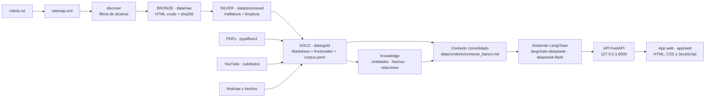
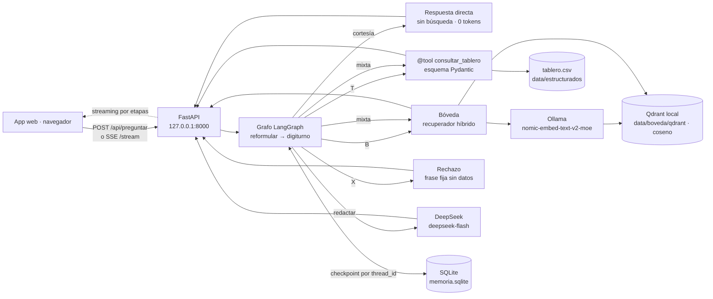

# Corpus web — Banco de Occidente

Pipeline **Medallion** (Bronze → Silver → Gold) del sitio público de **Banco de
Occidente** (`https://www.bancodeoccidente.com.co`) y asistente que responde solo
con el contexto consolidado del corpus, citando la fuente.

[](https://github.com/Darley843/Proyecto_BancoO/actions/workflows/ci.yml)


[](./LICENSE)

## Problema y solución

La información pública del banco está dispersa en ~200 páginas HTML, 190 PDFs y
32 videos, sin estructura común ni forma de citarla. Este proyecto la captura
respetando `robots.txt`, la limpia a un corpus Gold con frontmatter y consolida un
contexto único que alimenta un asistente LangChain con DeepSeek, con validación de
fuente y una app web local. El Módulo 1 usa el **contexto consolidado completo** en
el prompt de sistema; el Módulo 2 añade la Bóveda (fragmentos, Ollama/Qdrant y
recuperación híbrida), el Tablero de tarifas, el grafo con memoria y la app web de
la Sucursal 1965.

## Arquitectura



El grafo de la fase 2 decide la ruta antes de buscar y responde por SSE:



| Capa | Carpeta | Contenido | ¿Se versiona? |
|---|---|---|---|
| Bronze | `data/raw/` | HTML crudo, `urls.jsonl`, `capture.jsonl` con `sha256` | No |
| Silver | `data/processed/` | Markdown limpio, sin boilerplate | No |
| Gold | `data/gold/` | Markdown + frontmatter, `corpus.jsonl`, índices | **Sí** |
| Contexto | `data/contexto/` | Contexto consolidado y `manifest.json` | Sí |
| Knowledge | `data/knowledge/` | Entidades, hechos y relaciones con cita | Sí |

Gold es el entregable: de ahí se generan el contexto consolidado y el índice. Los
encabezados `##` son fronteras de *chunk* y los metadatos permiten citar el origen.

## Estado de la captura

| Métrica | Valor |
|---|---:|
| Documentos Gold | 241 (181 páginas web + 40 hechos + 20 noticias) |
| Tokens de las páginas Gold | 196.139 (promedio 813,9) |
| Documentos PDF y videos | 190 PDFs (10.954.933 tokens) · 32 videos (119.845 tokens) |
| Tokens del corpus completo | 11.270.917 |
| Contexto consolidado | 166.647 de 175.000 tokens (191 páginas incluidas, 50 excluidas) |
| Capa Knowledge | 2 entidades, 6 hechos, 1 relación (semilla validada) |
| Cobertura del checklist | 24/24 (heurística) |

Bronze y Silver no se versionan. En el checkout de Git solo se conserva **1 HTML**
de Bronze y Silver está vacío, así que un clon limpio **no puede regenerar** las
181 páginas web sin volver a capturar (`make all`; ver `CONSTITUTION.md` §14). El
repositorio versiona Gold, el contexto y los resultados de evaluación. Fuente:
`data/gold/_INDICE.md`, `corpus.jsonl` y `data/contexto/manifest.json`.

### Diagramas interactivos de la fase 2 (Archify)

El recorrido **navegador → FastAPI → grafo → Bóveda/Tablero → SQLite**, con
Ollama local y DeepSeek como servicio externo, vive en
[`docs/arquitectura.html`](./docs/arquitectura.html). Su fuente tipada es
`docs/arquitectura.json`; el HTML se genera, nunca se edita a mano.

El flujo de datos — **Gold → chunks → fragmentos → Ollama → Qdrant →
recuperación → respuesta citada**, y **PDF/tablas → CSV → plantilla** — vive en
[`docs/datos.html`](./docs/datos.html). Su fuente es `docs/datos.json` y también
se genera con Archify.

```bash
# una vez: instala Archify v3.2.0 en el commit auditado (Node >= 18).
# No uses `skills@latest`: actualizar exige repetir la auditoría
# (docs/auditoria-skills-proyecto.md).
tmp="$(mktemp -d)"
git init -q "$tmp"
git -C "$tmp" fetch -q --depth 1 https://github.com/tt-a1i/archify.git a4065941f12be7967436261d9934784e381d423c
git -C "$tmp" checkout -q FETCH_HEAD
rm -rf ~/.agents/skills/archify
mkdir -p ~/.agents/skills
cp -r "$tmp/archify" ~/.agents/skills/archify
rm -rf "$tmp"

# cada vez que cambie un diagrama
node ~/.agents/skills/archify/bin/archify.mjs finalize architecture \
  docs/arquitectura.json docs/arquitectura.html --repo-root . --quality showcase --json
node ~/.agents/skills/archify/bin/archify.mjs finalize dataflow \
  docs/datos.json docs/datos.html --repo-root . --quality showcase --json
```

En PowerShell, la instalación equivalente es la que se probó en Windows:

```powershell
$tmp = Join-Path $env:TEMP "archify-src"
git init -q $tmp
git -C $tmp fetch -q --depth 1 https://github.com/tt-a1i/archify.git a4065941f12be7967436261d9934784e381d423c
git -C $tmp checkout -q FETCH_HEAD
Remove-Item -Recurse -Force "$HOME\.agents\skills\archify" -ErrorAction SilentlyContinue
New-Item -ItemType Directory -Force "$HOME\.agents\skills" | Out-Null
Copy-Item -Recurse "$tmp\archify" "$HOME\.agents\skills\archify"
Remove-Item -Recurse -Force $tmp
```

La skill instalada debe tener 206 archivos, como en la auditoría.

En PowerShell el CLI queda en `$HOME\.agents\skills\archify\bin\archify.mjs`. La
corrida deja los recibos `docs/arquitectura.finalize*.json`,
`docs/arquitectura.browser-check.json` y los equivalentes `docs/datos.*.json`; si
algún gate falla, se corrige el JSON y se repite el comando completo.

## Requisitos e instalación

- Python 3.13 (uv lo instala si falta) y [uv](https://docs.astral.sh/uv/)
- GNU Make 4.x para los atajos (el CLI funciona sin `make`)
- `DEEPSEEK_API_KEY` solo para la app y la evaluación
- [Ollama](https://ollama.com/) con `nomic-embed-text-v2-moe` para la Bóveda
  (`ollama pull nomic-embed-text-v2-moe`); no necesita clave ni genera costo

El sitio está detrás de CloudFront y puede responder `403` a tráfico de VPN o
datacenter. Es una limitación documentada (`CONSTITUTION.md` §10): el pipeline se
detiene y la reporta, sin cambiar User-Agent, proxies ni red para sortear el WAF.

```bash
git clone https://github.com/Darley843/Proyecto_BancoO.git
cd Proyecto_BancoO
uv sync --all-extras
```

La clave del modelo se pasa por variable de entorno, sin archivos `.env`:

```powershell
# PowerShell
$env:DEEPSEEK_API_KEY = "<tu-clave>"
```

```bash
# bash / zsh
export DEEPSEEK_API_KEY="<tu-clave>"
```

Los comandos del corpus no necesitan la clave; solo la app y `make evaluar`.

## Uso

### Sucursal 1965 (app web de la fase 2)

```bash
make app            # o: uv run python app.py
```

Abre `http://127.0.0.1:8000`. `app.py` levanta FastAPI con uvicorn solo en
`127.0.0.1` y sirve la app web de `app/web/`, hecha con HTML, CSS y JavaScript
propios: sin frameworks, sin Node y sin paso de compilación.

| Ruta | Qué es |
|---|---|
| `app/web/index.html` | Armazón: encabezado, saldo del día y navegación de la sucursal |
| `app/web/estilos.css` | Identidad visual (colores como variables, modo oscuro, celular) |
| `app/web/app.js` | Cambia de vista y decide si usa la API o los datos de ejemplo |
| `app/web/comun.js` | Utilidades de presentación que comparten `app.js` y las vistas |
| `app/web/vistas/` | Una vista por archivo: `vestibulo`, `ventanilla`, `boveda`, `tablero`, `camara`, `arqueo`; cada una exporta `render(contenedor, estado)` |
| `app/web/datos-ejemplo/` | Un JSON por endpoint, con la misma forma que la API (`estado`, `preguntar`, `tablero`, `mapa`, `pipeline`, `arqueo`, `vestibulo`) |

**Maqueta frente a API.** Al abrir, `app.js` pide `/api/estado`. Si la API
responde, todas las vistas usan la API; si no, usan `app/web/datos-ejemplo/`
y el encabezado muestra el sello «Datos de ejemplo». Con `?ejemplo=1` en la
URL se fuerza la maqueta aunque la API esté encendida. Para revisar solo el
diseño, sin FastAPI ni claves:

```bash
uv run python -m http.server 8001 --directory app/web   # http://localhost:8001
```

### Pipeline y evaluación

```bash
uv run corpus all                        # discover -> fetch -> extract -> gold -> stats
uv run corpus docs all                   # PDFs (balances, informes)
uv run corpus videos all                 # canal de YouTube
uv run python -m banco_occidente_corpus.contexto   # contexto consolidado
make check                               # ruff + ty + pytest
make evaluar                             # 20 preguntas (requiere DEEPSEEK_API_KEY)
```

`make help` lista todos los atajos (`init`, `doctor`, `demo`, `health`, `deliver`, `clean`).

### Bóveda: fragmentos, índice y recuperación

La fase 2 deja de enviar el corpus completo al modelo: construye fragmentos,
los vectoriza con Ollama y recupera por similitud y por términos.

```bash
ollama pull nomic-embed-text-v2-moe     # una sola vez
make fragmentos                          # data/boveda/fragmentos_base.jsonl (sin red)
make indice                              # indexa web + PDF de producto + hechos
make indice-completo                     # añade el resto de PDF y los videos
make migrar-qdrant                       # copia un índice Chroma existente a Qdrant
```

| Pieza | Dónde | Qué hace |
|---|---|---|
| Fragmentos | `boveda/fragmentos.py` | Fusiona chunks hasta 80 tokens, limita a 400 y parte tablas largas por filas |
| Embeddings | `boveda/embeddings.py` | `nomic-embed-text-v2-moe` con `base_url` explícito y prefijos de tarea |
| Índice | `boveda/almacen.py` | Qdrant local en `data/boveda/qdrant`, colección `boveda` y coseno; Chroma opcional con `[almacen] tipo` |
| Recuperación | `boveda/recuperador.py` | Híbrido vectorial + BM25 con pesos de `config/sucursal.toml` |
| Mapa | `boveda/mapa.py` | PCA 2D de los vectores, normalizado de 0 a 100; se regenera en `make indice` |

El índice **no se versiona**: se regenera con `make indice`. La configuración
vive en `config/sucursal.toml` (`[embeddings]` y `[recuperacion]`); los
embeddings no usan `DEEPSEEK_API_KEY` ni aparecen en el consumo de DeepSeek.

### Digiturno

Antes de recuperar o consultar el Tablero, cada pregunta recibe un turno con una
letra:

| Letra | Ruta |
|---|---|
| `B` | Bóveda: consulta general |
| `T` | Tablero: tarifas, cuotas, coberturas o carencias |
| `X` | Rechazo: datos personales o fuera de alcance |

Las reglas van antes que el modelo (PII → fuera de alcance → tarifas → duda →
`B`), se configuran en `[digiturno]` de `config/sucursal.toml` y el modelo solo
se usa para dudas, a temperatura 0. El turno no persiste la pregunta.

### Tablero de tasas

Las cifras exactas (cuotas, coberturas, carencias, precios) no se dejan al
modelo: salen de un CSV determinista que se versiona.

```bash
make tablero    # tarifario PDF + tablas de Gold -> data/estructurados/tablero.csv
```

Cruza las 12 preguntas de tipo `tabla` del set de fase 2 y falla con el detalle si
alguna no encuentra fila. Cada fila trae `concepto`, `categoria`, `valor`,
`moneda`, `recargos`, `periodicidad`, `vigente_desde`, `origen`
(`tarifario`/`tabla_web`), `pagina` y `fuente`.

### Grafo con memoria

El grafo encadena `reformular → digiturno → Bóveda/Tablero/mixto/cortesía/rechazo → redactar`,
guarda la conversación con `SqliteSaver` en `data/asistente/memoria.sqlite` y
aísla cada sesión por `thread_id`. Un seguimiento se reformula solo si hay
historial; el Tablero responde sin modelo cuando hay 1-3 filas o varias del
mismo concepto (hasta 10), y la Bóveda toma el relevo con 0, más de 10 o
conceptos distintos. El `Store` de largo plazo con namespace
`perfil/cliente_local` no está implementado: el checkpointer guarda la
conversación, no las preferencias del cliente.

### API local y variables

`make app` levanta la API y la app web solo en `http://127.0.0.1:8000` (nunca
`0.0.0.0`). Endpoints: `/api/estado`, `POST /api/preguntar`, `POST /api/preguntar/stream`, `/api/tablero`,
`/api/boveda/mapa`, `/api/pipeline`, `/api/arqueo` y `/api/vestibulo`.

| Variable | Para qué |
|---|---|
| `DEEPSEEK_API_KEY` | respuestas con el modelo; sin ella, el asistente no puede redactar |
| `OLLAMA_HOST` / `OLLAMA_BASE_URL` | respaldo de la URL de embeddings; lo normal es `config/sucursal.toml` |
| `SUCURSAL_DEMO=1` | modo demo: sin DeepSeek, costo cero y sin escritura de gasto |
| `SUCURSAL_TOPE_USD` | sobrescribe el tope diario de `[sucursal]` para la sesión |

El gasto (`data/asistente/gasto.sqlite`) y la caché
(`data/asistente/cache.sqlite`) no se versionan.

### Preguntar

`POST /api/preguntar` recibe la pregunta y el hilo de la Ventanilla. El grafo, el
recuperador y el modelo se construyen en la primera pregunta del proceso, no al
importar `app.py`. El Digiturno decide la letra: `B` (Bóveda), `T` (Tablero con
plantilla) o `X` (rechazo). El campo `ruta` distingue además `cortesia`,
`mixta` y `perfil`; las letras no cambian.

```bash
curl -s http://127.0.0.1:8000/api/preguntar \
  -H "Content-Type: application/json" \
  -d '{"pregunta": "¿Cuál es la cuota de manejo de la tarjeta débito?", "thread_id": "ses-abc", "perfil_id": "perfil-demo"}'
```

Request:

```json
{
  "pregunta": "¿Cuál es la cuota de manejo de la tarjeta débito?",
  "thread_id": "ses-abc",
  "perfil_id": "perfil-demo"
}
```

`perfil_id` es opcional: identifica la memoria de largo plazo (nombre y empresa)
que la Ventanilla guarda en `localStorage`. Sin él, una pregunta de perfil
responde que la memoria no está activa; el resto de rutas funciona igual.

Response 200, con la misma forma que `app/web/datos-ejemplo/preguntar.json`:

```json
{
  "turno": "T",
  "turno_numero": 12,
  "ruta": "tablero",
  "motivo": "tarifas",
  "uso_modelo": false,
  "reformulada": null,
  "respuesta": "Según el Tablero de tarifas:\n- Cuota de manejo tarjeta débito: 16.700 COP (mensual), vigente desde 2025-11-20\n\nFuentes:\n- https://www.bancodeoccidente.com.co/documents/d/guest/tarifas-persona-1",
  "fuentes": [
    {
      "n": 1,
      "titulo": "Cuota de manejo tarjeta débito",
      "url": "https://www.bancodeoccidente.com.co/documents/d/guest/tarifas-persona-1",
      "seccion": "otros",
      "tipo": "pdf",
      "similitud": null
    }
  ],
  "tokens_entrada": 0,
  "tokens_salida": 0,
  "tokens_cache": 0,
  "costo_usd": 0.0,
  "tiempo_s": 0.03,
  "cache": false
}
```

- `reformulada` es `null` cuando el grafo no reformuló; en un seguimiento trae la
  pregunta autónoma.
- `fuentes` solo trae objetos en `B` y `T` (en `X` va vacía); `similitud` es `null`
  cuando la fuente viene del Tablero, que no tiene puntaje.
- Un acierto de caché devuelve `cache: true` con tokens y costo en cero, y aun así
  deja el turno en el hilo para el seguimiento siguiente.
- El turno cobra una sola vez el total de las tres llamadas al modelo (reformular,
  clasificar y redactar); `llamadas` refleja el número real de invocaciones.

Errores, siempre como `{"error": {"codigo", "mensaje"}}`:

| HTTP | `codigo` | Cuándo |
|---|---|---|
| 422 | `pregunta_vacia` | la pregunta llega vacía |
| 422 | `thread_id_ausente` | falta el hilo de la conversación |
| 429 | `tope_alcanzado` | el gasto del día llegó al tope y la ruta necesita modelo |
| 503 | `indice_no_listo` | falta `data/boveda/indice.json`; ejecuta `make indice` |
| 503 | `sin_clave` | falta `DEEPSEEK_API_KEY` fuera de demo; usa `SUCURSAL_DEMO=1` |

Con `SUCURSAL_DEMO=1` la Bóveda responde con el fragmento principal y su fuente,
marcado como demo, sin crear el modelo ni escribir gasto.

### Preguntar con streaming

`POST /api/preguntar/stream` recibe el mismo cuerpo y atiende el turno con el
mismo servicio (caché, tope, memoria y blindaje), pero responde
`text/event-stream` con el avance del grafo. La Ventanilla lo usa para mostrar
las etapas mientras espera y guarda el «Recorrido del turno» en el comprobante.

```bash
curl -sN http://127.0.0.1:8000/api/preguntar/stream \
  -H "Content-Type: application/json" \
  -d '{"pregunta": "¿En qué año se fundó el Banco de Occidente?", "thread_id": "ses-abc"}'
```

| Evento | Cuándo | `data` |
|---|---|---|
| `etapa` | cada nodo empieza (`en_curso`) y termina (`hecho`) | `{nodo, etapa, estado, texto, detalle}`; `etapa` es `reformulando`, `router`, `buscando` o `redactando` |
| `final` | el turno terminó | el mismo cuerpo de `POST /api/preguntar` |
| `error` | un nodo falló a mitad del turno | `{"error": {"codigo": "error_interno", "mensaje"}}` |

- Las etapas salen de `grafo.stream(stream_mode=["tasks", "values"])` y nunca
  llevan la pregunta, la respuesta ni el hilo. La respuesta solo llega en `final`,
  ya validada con sus citas: no se transmite texto que el blindaje no revisó.
- Los rechazos previos al grafo (422, 429 y 503 de la tabla anterior) responden
  con su estado HTTP y el JSON de siempre, sin abrir el streaming.
- Un acierto de caché no ejecuta nodos: llega solo el evento `final`.
- Si la conexión se corta, la Ventanilla muestra el error con «Reintentar» y el
  hilo se conserva. `POST /api/preguntar` sigue igual para la evaluación y las pruebas.

### Scraper de demostración

Capa delgada sobre el pipeline: descubre hasta 5 URLs con el índice de sitemaps
(`robots.txt` y filtros de `config/site.toml` incluidos), las captura con
`net.HttpClient` y ejecuta Bronze → Silver → Gold con el contrato oficial. No
tiene cliente HTTP ni formato propios.

```bash
uv run python scripts/scrape_empresa.py          # 5 páginas en .demo/scrape_empresa/
uv run scripts/scrape_empresa.py --limit 3      # la misma demo, sin `python`
uv run python scripts/scrape_empresa.py --out .demo/prueba --delay 2
```

La salida por defecto es `.demo/scrape_empresa/` (ignorada por Git) con las capas
`raw/`, `processed/` y `gold/`. `--out` rechaza cualquier ruta dentro de `data/`.
Al final imprime el resumen por etapa y la ruta de una página Gold generada. Ante
un `403` o `429` se detiene con un mensaje neutro, sin cambiar de red ni de
cliente.

## Capturas

La app vigente es `app/web/` y se abre con `make app` en
`http://127.0.0.1:8000`. Sus seis vistas son Vestíbulo, Ventanilla, Bóveda,
Tablero, Cámara y Arqueo. Las imágenes de `docs/capturas/` pertenecen a la app
Streamlit retirada en la fase 2 y se conservan solo como registro histórico; las
capturas vigentes deben tomarse de la app web.

## Resultados de la evaluación

`make evaluar` corre las 20 preguntas del alcance con el mismo flujo que la app:
prompt `qa_v1`, contexto completo y validación de fuente. La clasificación
automática solo ordena el trabajo; lo que se reporta es la revisión humana.

La revisión humana vive en `config/evaluacion/revision_humana.toml` (veredicto,
nota y revisor por pregunta), así que volver a correr la evaluación no la borra.
Una fila sin revisor, o con «propuesta» en el revisor, sale marcada como
propuesta pendiente de confirmar.

```bash
make evaluar SOLO=4,17        # repite solo esas preguntas y conserva las demás filas
make evaluar REVALIDAR=1      # sin API: revalida las respuestas guardadas y aplica la revisión
make evaluar VERSION=v2       # fase 2: 44 preguntas con el grafo -> docs/RESULTADOS_FASE2.md
```

La evaluación `VERSION=v2` responde con el grafo de la Sucursal (Bóveda, Tablero y
memoria por `thread_id`) en lugar del contexto completo, envía la pregunta previa
de cada seguimiento en el mismo hilo y escribe
`data/evaluacion/resultados_v2.jsonl` y
[`docs/RESULTADOS_FASE2.md`](./docs/RESULTADOS_FASE2.md) sin tocar los archivos de v1.

Resultados vigentes y respuestas completas de v1:
[`docs/RESULTADOS_20_PREGUNTAS.md`](./docs/RESULTADOS_20_PREGUNTAS.md).

## Estructura del repositorio

```text
├── app.py                     # arranque: FastAPI + app web en 127.0.0.1:8000 (make app)
├── app/
│   └── web/                   # Sucursal 1965: index.html, estilos.css, app.js, vistas/, datos-ejemplo/
├── src/banco_occidente_corpus/
│   ├── net.py · discover.py · fetch.py · extract.py · dedupe.py
│   ├── section.py · gold.py · checklist.py · stats.py · cli.py
│   ├── panel.py               # lectura de artefactos para la app (sin red)
│   ├── live_capture.py        # captura en vivo en carpeta temporal
│   ├── contexto.py · knowledge.py · documents.py · videos.py · news.py
│   ├── asistente/             # Q&A, FAQ, resumen y evaluación con DeepSeek
│   ├── boveda/               # fragmentos, embeddings, índice Qdrant y recuperador
│   ├── sucursal/             # digiturno (B/T/X), grafo y API de la fase 2
│   └── tablero/              # tarifario y tablas de Gold → data/estructurados/tablero.csv
├── scripts/                   # demo_offline.py · scrape_empresa.py · tasks.py
├── config/ · data/ · docs/    # configuración, capas y documentación
├── config/sucursal.toml       # embeddings y recuperación de la fase 2
├── test/                      # pytest con fixtures locales, sin red
├── makefile · pyproject.toml · uv.lock
└── CONSTITUTION.md · AGENTS.md
```

## Contrato de Gold

```yaml
---
fuente: https://www.bancodeoccidente.com.co/quienes-somos
titulo: Quiénes somos
seccion: identidad        # identidad | oferta | presencia | datos | atencion | legal
tokens: 812
hash: 3f9c1a7d
---
```

Un `.md` por URL con nombre estable, `corpus.jsonl` como fuente del índice y del
asistente, y `hash` para detectar cambios. Gold **nunca** se edita a mano: se
regenera con `make gold`. Contrato completo en [`CONSTITUTION.md`](./CONSTITUTION.md) §7.

## Knowledge, documentos y videos

- **Knowledge**: entidades, hechos y relaciones con cita obligatoria (`CONSTITUTION.md` §7).
- **Documentos y videos**: solo material público, prioridad por año y trazabilidad por hash.

## Noticias y hechos relevantes

`make noticias` genera fichas de prensa verificada y de la tabla «Información Relevante», y
no forma parte de `make all`, `make gold`, `make deliver`, `make docs`, `make docs-finanzas`,
`make videos` ni `make media`; la curaduría vive en `data/noticias/prensa.yaml`.

## Documentación

[`CONSTITUTION.md`](./CONSTITUTION.md) (verdad central) · [`docs/ESTANDAR.md`](./docs/ESTANDAR.md)
(trazabilidad) · [`docs/FUENTES.md`](./docs/FUENTES.md) (fuentes y `robots.txt`) ·
[`docs/ALCANCE.md`](./docs/ALCANCE.md) (20 preguntas) ·
[`docs/MODELADO.md`](./docs/MODELADO.md) (Módulos 1 y 2) ·
[`docs/ARQUEO.md`](./docs/ARQUEO.md) (recuperación, evaluación y costo) ·
[`docs/RESULTADOS_FASE2.md`](./docs/RESULTADOS_FASE2.md) (44 preguntas de la fase 2) ·
[`docs/SEGURIDAD.md`](./docs/SEGURIDAD.md) (modelo de amenazas) ·
[`AGENTS.md`](./AGENTS.md).

## Ética y legalidad

- `robots.txt` manda: lo que está en `Disallow` no se toca (`/portaltransaccional/`, `/icbs-web/`, `/AjaxTx`, `/wps/`).
- Ritmo de cortesía de 1,5 s entre peticiones (decisión del proyecto; `robots.txt`
  no declara `Crawl-delay`) y pausa de 10 s cada 50.
- User-Agent de navegador y header `From` con el contacto académico (`config/site.toml`).
- Solo información pública, sin zonas privadas, formularios ni datos personales
  (Ley 1581 de 2012); el HTML crudo se conserva para reprocesar sin molestar al sitio.

## Limitaciones y solución de problemas

- **Bloqueo del WAF (`403`)**: limitación documentada en `CONSTITUTION.md` §10.
  El pipeline se detiene e informa; no cambia el User-Agent, no usa proxies ni
  navegadores y no busca otra red para sortear el WAF.
- **`make` no existe en Windows**: `winget install ezwinports.make` o
  `choco install make`. También puede usarse `uv run corpus <comando>`.
- **Sin `DEEPSEEK_API_KEY`**: la app avisa y sigue en pie; el pipeline no la necesita.

## Licencia

[MIT](./LICENSE). El contenido del corpus pertenece a sus titulares y se usa con
fines académicos, citando la fuente en el frontmatter de cada documento. La
atribución de materiales de terceros está en [`NOTICE.md`](./NOTICE.md).

## Créditos

| Persona | Rol |
|---|---|
| Darley Idárraga | Líder de repositorio e integración |
| Yoldy Benavides | Ingeniería de datos |
| Nayla Ledesma | Método y memoria; asistente LangChain y app web |
| Anny Valencia | Seguridad y calidad |

Curso **TAAML**, Universidad Autónoma de Occidente (UAO).

## Referencias

- [uv](https://docs.astral.sh/uv/) · [trafilatura](https://trafilatura.readthedocs.io/)
- [RFC 9309 — robots.txt](https://www.rfc-editor.org/rfc/rfc9309) · [Sitemaps](https://www.sitemaps.org/protocol.html)
- [LangChain](https://python.langchain.com/) · [DeepSeek](https://api-docs.deepseek.com/)
