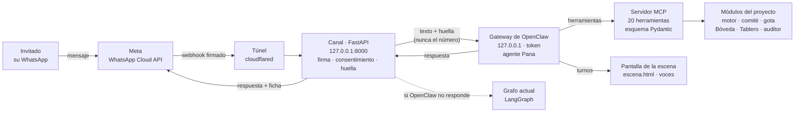

# Guía de despliegue de la Sucursal 1965

Cómo poner a funcionar, en un computador con Windows, todo lo que se ve en la
sustentación: el WhatsApp de Pana, el agente en OpenClaw, el servidor MCP con
sus herramientas, la app web y la pantalla de la escena. Está pensada para que
alguien que no hizo el proyecto lo despliegue **sin preguntarle a nadie**.

Cada sección dice quién la mantiene. Las marcadas con **⏳ por completar** se
llenan cuando su pieza entre a `main`; mientras tanto dicen qué va a ir ahí.

| Sección | Mantiene | Estado |
|---|---|---|
| [1. Requisitos](#1-requisitos) | Yoldy | Listo |
| [2. Código, datos y app](#2-código-datos-y-app) | Yoldy | Listo |
| [3. WhatsApp por Meta](#3-whatsapp-por-meta) | Darley | Listo con el número de prueba; ⏳ SIM nueva y modo evento |
| [4. Túnel](#4-túnel) | Darley | Listo |
| [5. Gateway de OpenClaw](#5-gateway-de-openclaw) | Nayla | Listo |
| [6. Servidor MCP y herramientas](#6-servidor-mcp-y-herramientas) | Nayla | Listo |
| [7. Pantalla de la escena](#7-pantalla-de-la-escena) | Yoldy | Listo |
| [8. Encender todo en orden](#8-encender-todo-en-orden) | Todos | Listo; ⏳ se completa con 3, 5 y 6 |
| [9. Comprobar de punta a punta](#9-comprobar-de-punta-a-punta) | Todos | Listo |
| [10. Apagar y limpiar](#10-apagar-y-limpiar) | Todos | Listo |

## Cómo encaja todo



Todo corre en el mismo computador y escucha solo en `127.0.0.1`. Lo único que
llega desde afuera es el webhook de Meta, por el túnel. WhatsApp va solo por
Meta: OpenClaw no es un segundo canal, es el cerebro detrás del canal.

## 1. Requisitos

| Qué | Para qué | Cómo comprobarlo |
|---|---|---|
| Windows 10/11 con PowerShell | Todos los comandos de esta guía | — |
| [uv](https://docs.astral.sh/uv/) | Python 3.13 y dependencias (nunca `pip`) | `uv --version` |
| Git y GNU Make 4.x | Clonar y atajos `make` | `git --version`, `make --version` |
| [Ollama](https://ollama.com/) con `nomic-embed-text-v2-moe` | Embeddings de la Bóveda (local, sin costo) | `ollama list` |
| Clave de DeepSeek con saldo | Redactar respuestas | `$env:DEEPSEEK_API_KEY` definida |
| `cloudflared` | Túnel para el webhook de Meta | `cloudflared --version` |
| Node.js 24 y OpenClaw | Gateway del agente | `openclaw --version` (sección 5) |
| Microsoft Edge | Pantalla de la escena y voces de Edge | — |

Ninguna clave, token, `.env` ni número real va en el repositorio. Las variables
se cargan por sesión de PowerShell (`docs/SEGURIDAD.md` §4).

## 2. Código, datos y app

```powershell
git clone https://github.com/Darley843/Proyecto_BancoO.git
cd Proyecto_BancoO
uv sync --all-extras
ollama pull nomic-embed-text-v2-moe
make indice          # Bóveda en Qdrant local (data/boveda/, no se versiona)
make tablero         # tabla de tasas y tarifas
make voz-modelo      # una vez: voces de Piper de la escena
make check           # lint + tipos + pruebas, debe quedar en verde
```

La app:

```powershell
$env:DEEPSEEK_API_KEY = "<tu-clave>"
make app             # http://127.0.0.1:8000
```

Sin `DEEPSEEK_API_KEY` o con `$env:SUCURSAL_DEMO = "1"`, la app responde en
**modo demo**, sin gastar saldo. Para probar el canal sin WhatsApp ni claves:
`make simular`.

## 3. WhatsApp por Meta

*Mantiene: Darley.* El paso a paso completo, con capturas de qué pegar en cada
campo de Meta, está en [`OPERACION_WHATSAPP.md`](./OPERACION_WHATSAPP.md).
Resumen:

1. App de Meta tipo Business **publicada** (modo Activo), con el producto
   WhatsApp.
2. Token permanente de un usuario del sistema con
   `whatsapp_business_messaging` y `whatsapp_business_management`.
3. Variables en `whatsapp-env.ps1`, **fuera del repositorio**:
   `WHATSAPP_PHONE_NUMBER_ID`, `WHATSAPP_APP_SECRET`, `WHATSAPP_VERIFY_TOKEN`,
   `WHATSAPP_ACCESS_TOKEN`, `WHATSAPP_ID_SALT` y `WHATSAPP_MODO`
   (`falso` o `real`).
4. Cuenta de WhatsApp suscrita a la app y callback
   `https://<url-del-túnel>/webhooks/whatsapp` registrado en Meta.

### ⏳ Número nuevo y modo evento (por completar)

Lo completa Darley cuando el número esté verificado:

- Cómo se agregó la SIM nueva a la cuenta de WhatsApp Business y se verificó.
- Qué valor cambia en la configuración para usar ese número.
- **Modo evento**: los números que no están registrados pueden escribir, pero
  primero aceptan el consentimiento (Ley 1581); límite de mensajes por número y
  tope diario de DeepSeek. Cómo se activa y cómo se apaga al terminar.

## 4. Túnel

*Mantiene: Darley.* Meta solo entrega el webhook a una URL pública con HTTPS.

```powershell
cloudflared tunnel --url http://127.0.0.1:8000
```

La URL `https://….trycloudflare.com` **cambia cada vez** que el túnel se
reinicia; hay que actualizarla en Meta → Webhooks y pulsar **Verificar y
guardar**. Si no está instalado:
`winget install --id Cloudflare.cloudflared -e`.

## 5. Gateway de OpenClaw

*Mantiene: Nayla.* El detalle de cada archivo está en
[`openclaw/README.md`](../openclaw/README.md) y el contrato en el cambio
OpenSpec `agente-openclaw`.

**Dónde corre.** El gateway corre dentro de **WSL**, en la distribución
`OpenClawGateway`, con el usuario `openclaw`.

**Arranque.** Deja abierta una pestaña de PowerShell con la distribución
levantada:

```powershell
wsl -d OpenClawGateway
```

Para reiniciar el gateway sin entrar a la distribución:

```powershell
wsl -d OpenClawGateway -- openclaw daemon restart
```

Y para revisar que responde:

```powershell
wsl -d OpenClawGateway -- openclaw health
```

`openclaw mcp doctor` y `mcp probe` solo funcionan con el gateway **apagado**:
con el demonio arriba no ven las herramientas. Se detiene, se comprueba y se
vuelve a arrancar:

```powershell
wsl -d OpenClawGateway -- openclaw daemon stop
wsl -d OpenClawGateway -- openclaw mcp doctor sucursal --probe
wsl -d OpenClawGateway -- openclaw daemon start
```

**Red espejo.** El gateway vive en WSL y el servidor MCP en Windows, en
`127.0.0.1:8765`. En `%USERPROFILE%\.wslconfig` se declara:

```ini
[wsl2]
networkingMode=mirrored
```

y se reinicia WSL desde PowerShell:

```powershell
wsl --shutdown
```

Con eso el gateway alcanza el MCP en `127.0.0.1:8765`, así que el plan B de
instalar el gateway directo en Windows no fue necesario.

| Tema | Cómo queda |
|---|---|
| Escucha | `127.0.0.1:18789` (`bind: loopback`): no sale a la red local ni a internet |
| Autenticación | Token en cada petición. El token real sigue en la configuración del gateway en WSL, protegida con `chmod 700`; al exportar la configuración al repo, `scripts\exportar_config_openclaw.ps1` lo reemplaza por `${OPENCLAW_GATEWAY_TOKEN}`. Moverlo a un almacén de secretos queda para después de la entrega |
| API | `POST /v1/chat/completions` activado (misma forma que OpenAI). El canal manda `user = "wa:<huella>"`: cada invitado tiene su hilo y el número nunca viaja |
| Modelo | `deepseek/deepseek-flash` principal y `deepseek/deepseek-v4-pro` alternativo |
| Agente `pana` | Perfil de herramientas `minimal` con lista `deny` (sin terminal, archivos, navegador, mensajes propios ni subagentes), `skills: []`, `thinkingDefault: "off"` (sin razonamiento, responde más rápido), `dreaming` apagado en `memory-core` y sin tareas programadas |
| Archivos | `tools.fs.workspaceOnly: true` y sin permisos elevados |
| Canal WhatsApp del gateway | **Apagado**: WhatsApp va solo por Meta (sección 3) |

**Workspace de Pana.** La fuente de verdad es el repositorio
(`openclaw/workspace/pana/`: `SOUL.md`, `AGENTS.md`, `USER.md`, `IDENTITY.md`).
Después de cada cambio se copia a WSL:

```powershell
powershell -ExecutionPolicy Bypass -File scripts\sincronizar_workspace.ps1
```

El script no toca `MEMORY.md` ni la bitácora del día. Nunca se edita el
workspace de WSL a mano.

**Configuración versionada.** `openclaw/openclaw.json` es una copia sin
secretos de la configuración real de WSL. Si la configuración cambia, se vuelve
a exportar (el script borra tokens, claves y teléfonos, y falla si queda algo
con pinta de clave):

```powershell
powershell -ExecutionPolicy Bypass -File scripts\exportar_config_openclaw.ps1
```

**Auditoría de seguridad.** `openclaw security audit` no reporta ninguna
crítica y deja dos advertencias justificadas. El resultado y la razón de cada
una están en la sección
[«Auditoría de seguridad»](../openclaw/README.md#auditoría-de-seguridad) de
`openclaw/README.md`.

**Respaldo.** Si el gateway no responde, el canal contesta con el grafo actual.
Para forzarlo durante la demo: `$env:OPENCLAW_ACTIVO = "0"` antes de `make app`
(⏳ llega con la tarea 1.5).

Comprobación mínima: una pregunta enviada por HTTP al gateway devuelve la
respuesta del agente, y en la traza se ve qué herramienta eligió.

## 6. Servidor MCP y herramientas

*Mantiene: Nayla, con las herramientas de Darley y Anny.*

El servidor `sucursal-agente` expone las **20 herramientas** del agente por HTTP
en `127.0.0.1:8765/mcp` (tabla en el
[README](../README.md#las-20-herramientas)). Se arranca en su propia pestaña:

```powershell
make agente-mcp      # servidor MCP en 127.0.0.1:8765/mcp
make herramientas    # lista las 20 y sus esquemas Pydantic (JSON=1 para JSON)
make traza           # últimas llamadas, sin textos libres ni datos personales
```

`make herramientas` imprime nombre, dueña, entrada y salida de cada una;
`make traza` lee la traza local de cada llamada. **Ollama tiene que estar
encendido**, porque `buscar_en_documentos` consulta la Bóveda. Después de
cambiar el código de las herramientas hay que reiniciar `make agente-mcp`: el
gateway no recarga el proceso por su cuenta.

**Cómo lo ve el gateway.** `openclaw/openclaw.json` declara el servidor con la
lista cerrada de veinte herramientas:

```json
"mcp": {
  "servers": {
    "sucursal": {
      "url": "http://127.0.0.1:8765/mcp",
      "transport": "streamable-http",
      "enabled": true,
      "connectionTimeoutMs": 5000,
      "requestTimeoutMs": 8000,
      "toolFilter": {
        "include": [
          "consultar_tasa", "simular_cuota", "verificar_usura",
          "diagnosticar_capacidad", "comparar_escenario", "convocar_comite",
          "calcular_prestamo_gota", "comparar_gota_banco", "negociar_opcion",
          "generar_ficha_opcion", "responder_sobre_proyecto",
          "registrar_consentimiento", "olvidar_mis_datos", "solicitar_asesor",
          "consultar_caso", "generar_tarjeta_pana", "buscar_en_documentos",
          "consultar_tarifas", "clasificar_pregunta", "auditar_respuesta"
        ]
      }
    }
  }
}
```

El perfil `minimal` de Pana no expone los servidores MCP por sí solo, así que su
política de herramientas incluye `bundle-mcp` además de la lista `deny`:

```json
"agents": { "entries": { "pana": { "tools": { "alsoAllow": ["bundle-mcp"] } } } }
```

Con eso, el gateway solo ve las veinte: lo que no está en `toolFilter.include`
no existe para el agente. Para comprobarlo,
`openclaw mcp doctor sucursal --probe` devuelve `sucursal: ok`; recuerda que ese
comando corre con el gateway apagado (sección 5). Desde WSL, el gateway alcanza
`127.0.0.1:8765` por la red espejo.

Las herramientas que borran datos o crean casos (`olvidar_mis_datos`,
`solicitar_asesor`) **piden confirmación**. El servidor de solo lectura por
stdio (`uv run python -m banco_occidente_corpus.mcp_servidor`, detalle en
[`MCP.md`](./MCP.md)) sigue disponible para pruebas sin puerto.

## 7. Pantalla de la escena

*Mantiene: Yoldy.* La pantalla es una página aparte de la app. Detalle en
[`ESCENA.md`](./ESCENA.md) y las voces en [`VOZ.md`](./VOZ.md).

```powershell
make escena-proyectada   # escena de respaldo en data/escena/ (sin DeepSeek)
make voces-prueba        # una muestra por personaje
make app
```

1. Abrir `http://127.0.0.1:8000/escena.html` en **Edge**, con internet (la voz
   de Pana es de Edge; sin internet vuelve sola a Piper).
2. Pantalla completa con **F11** y zoom al 100 %.
3. Probar dos turnos con voz y la tecla **S** (solo subtítulos).

| Tecla | Qué hace |
|---|---|
| Espacio / → | Siguiente turno |
| P | Reproducir o pausar |
| S | Solo subtítulos (respaldo si falla el sonido) |
| Q | Preguntas del público a Pana |
| N | Núcleo: Don Gota, Pana y auditor, sin repetir turnos |
| T | Panel de trazabilidad (solo para quien facilita) |
| R | Reiniciar |

Si el servidor no responde, la pantalla usa la última escena guardada en la
pestaña y, si no hay, los turnos de ejemplo, con un sello que lo dice.

**Qué funciona hoy y qué falta:**

| Pieza | Estado |
|---|---|
| Escena proyectada (`GET /api/escena/proyectado` y `make escena-proyectada`) | Lista desde #188. Sin ella, la pantalla muestra los turnos de ejemplo con su sello |
| Preguntas del público (tecla Q) | `POST /api/escena/pregunta`: las 22 respuestas fijas de `config/escena.toml`, la documentación del proyecto y, si el servidor no responde, la ficha local de Pana |
| Entrada del voluntario por voz (tecla V) | `POST /api/escena/hablar`: con `pregunta` interpreta la letra o el monto y devuelve la línea de Pana; sin `pregunta` pasa la frase libre por los filtros del canal, el motor y el envío por WhatsApp al voluntario activo, con la ficha si la hay. No recibe audio, no guarda texto y rechaza datos personales |
| Recursos (tecla G) | `GET /api/escena/repositorio` y su QR, el QR de WhatsApp opcional y los seis diagramas de `docs/` |
| Turnos en vivo publicados por el agente de OpenClaw | ⏳ Llegan con la integración del miércoles 25 (OpenClaw publica cada turno y la pantalla lo muestra) |

## 8. Encender todo en orden

El sábado 28 a las 7:30 a. m. Cada ventana de PowerShell desde la raíz del
repositorio.

| Ventana | Qué | Comando |
|---|---|---|
| 1 | App y canal | `. "..\whatsapp-env.ps1"`, `$env:WHATSAPP_MODO = "real"`, `make app` |
| 2 | Túnel | `cloudflared tunnel --url http://127.0.0.1:8000` y actualizar la URL en Meta |
| 3 | Gateway de OpenClaw | `scripts\sincronizar_workspace.ps1` y arranque en WSL (⏳ sección 5) |
| 4 | Servidor MCP | ⏳ sección 6 |
| Edge | Pantalla | `http://127.0.0.1:8000/escena.html`, F11 |

La lista de verificación completa del día está en
[`LISTA_DEMO.md`](./LISTA_DEMO.md).

## 9. Comprobar de punta a punta

```powershell
. "..\whatsapp-env.ps1"
curl.exe "http://127.0.0.1:8000/health"
curl.exe "https://<url-del-túnel>/webhooks/whatsapp?hub.mode=subscribe&hub.verify_token=$env:WHATSAPP_VERIFY_TOKEN&hub.challenge=12345"
```

- [ ] `/health` responde 200 y el segundo comando devuelve `12345`.
- [ ] Un `hola` desde un teléfono produce el aviso de la Ley 1581; tras
      **Acepto**, una pregunta del banco se responde con su fuente.
- [ ] ⏳ La respuesta viene del agente de OpenClaw (se ve en su traza) y, con el
      gateway apagado, el canal responde con el grafo actual.
- [ ] La pantalla muestra la escena con voz y, con la tecla S, solo subtítulos.
- [ ] Al final de la escena llega la ficha de la opción recomendada:
      simulación orientativa, nunca «aprobado».

## 10. Apagar y limpiar

Al terminar la sustentación:

1. ⏳ Apagar el **modo evento** (sección 3) para que nadie más pueda escribir.
2. Cerrar el túnel (Ctrl+C en la ventana 2) y quitar la URL del webhook en
   Meta.
3. Apagar el gateway, el MCP y la app.
4. Cerrar la sesión de PowerShell donde estaban las claves.

Los datos de la escena (`data/escena/`) y los SQLite del canal no se versionan;
los datos de los invitados vencen solos según `config/whatsapp.toml`, y
cualquiera puede borrarlos antes escribiendo «olvida mis datos».
