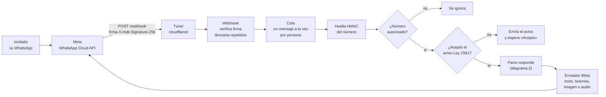
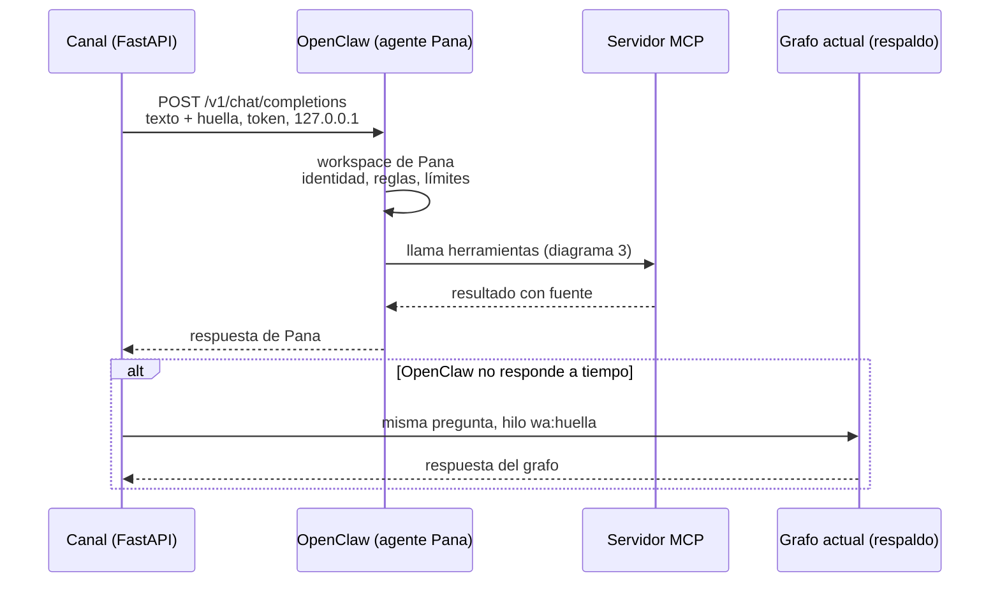
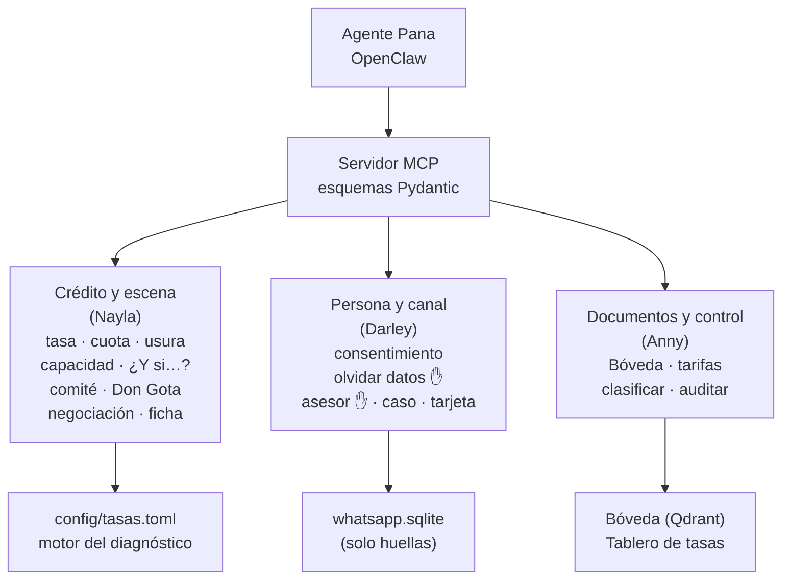
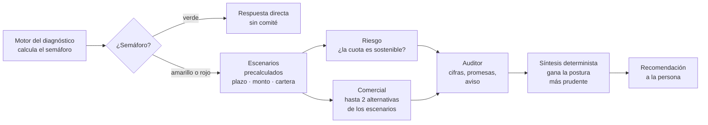
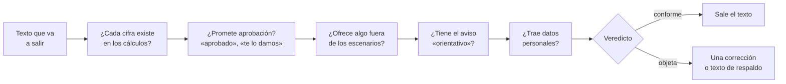
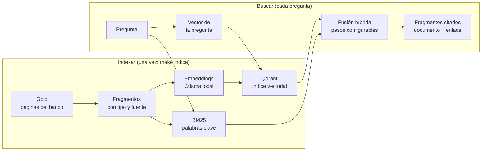
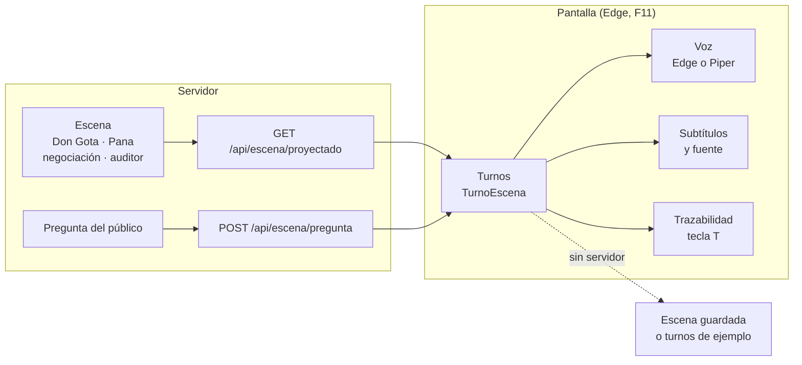

# Diagramas de la entrega final

Siete diagramas para explicar Sucursal 1965 en la parte técnica de la
sustentación. Cada uno se lee de izquierda a derecha o de arriba abajo. El
recorrido completo está en el [README](../README.md#arquitectura-de-la-entrega-final)
y el encendido paso a paso en [`DESPLIEGUE.md`](./DESPLIEGUE.md).

| # | Diagrama | Qué responde |
|---|---|---|
| 1 | [Canal de Meta](#1-canal-de-meta) | ¿Qué pasa con un mensaje de WhatsApp antes de llegar a Pana? |
| 2 | [Gateway de OpenClaw](#2-gateway-de-openclaw) | ¿Cómo habla el canal con el agente y qué pasa si se cae? |
| 3 | [MCP y herramientas](#3-mcp-y-herramientas) | ¿Qué puede hacer el agente y de dónde salen las cifras? |
| 4 | [Comité de crédito](#4-comité-de-crédito) | ¿Quién decide qué recomendar en un caso amarillo o rojo? |
| 5 | [Auditor](#5-auditor) | ¿Qué revisa cada respuesta antes de salir? |
| 6 | [RAG de la Bóveda](#6-rag-de-la-bóveda) | ¿Cómo encuentra Pana el documento correcto? |
| 7 | [Escena en pantalla](#7-escena-en-pantalla) | ¿Cómo llegan los turnos a la pantalla con voz y subtítulos? |

## 1. Canal de Meta

- El número de teléfono **nunca sale del canal**: todo lo demás trabaja con la
  huella. El número y el texto no se escriben en los logs.
- «Olvida mis datos» borra consentimiento, entrevistas, resultados y casos.
- Código: `canal/webhook.py`, `canal/cola.py`, `canal/identidad.py`,
  `canal/consentimiento.py`, `canal/despachador.py`, `canal/envio.py`.

## 2. Gateway de OpenClaw

- El gateway escucha solo en `127.0.0.1` y pide token: no queda expuesto a
  internet. El túnel solo publica el webhook del canal.
- Si OpenClaw falla, el invitado igual recibe respuesta: la da el grafo de
  LangGraph que ya funcionaba (digiturno, Bóveda, entrevista, tarjeta).
- ⏳ Puerto, modelo y archivos del workspace: los completa Nayla en
  [`DESPLIEGUE.md`](./DESPLIEGUE.md#5-gateway-de-openclaw).

## 3. MCP y herramientas

- ✋ = la herramienta pide confirmación de la persona antes de actuar.
- Las cifras **siempre** salen de código o de configuración con fuente; el
  modelo no inventa tasas ni cuotas.
- Lista completa: [las 20 herramientas](../README.md#las-20-herramientas).

## 4. Comité de crédito

- El comité **no cambia el semáforo**: solo decide qué recomendar.
- Una ronda, máximo 4 llamadas al modelo y 30 segundos. Si el auditor objeta
  dos veces, se responde con el texto del diagnóstico.
- Nunca recibe el nombre ni el número de la persona.
- Código: `diagnostico/comite.py`. Detalle: [`COMITE.md`](./COMITE.md).

## 5. Auditor

- Es **código**, no solo un prompt: `auditar_texto` en
  `diagnostico/comite.py` lo usan el comité, la escena y la herramienta
  `auditar_respuesta`.
- En la pantalla, el veredicto aparece solo después de que el auditor habla.

## 6. RAG de la Bóveda

- Híbrido: el vector entiende el sentido, BM25 atrapa nombres exactos
  («Crediestudiantil», «GMF»).
- Cada respuesta cita el documento y el fragmento de donde salió.
- Código: `boveda/recuperador.py`, `boveda/indice.py`.

## 7. Escena en pantalla

- Cada turno trae quién habla, el texto, las cifras con su fuente y lo que
  dijo el auditor. La fuente va en el subtítulo, no en la voz.
- Si falla la voz: modo **solo subtítulos** (tecla S). Si falla el servidor:
  la pantalla usa la última escena guardada.
- Don Gota **nunca** es un modelo: sus cifras salen de `escena/gota.py`.
- Teclas y ensayo: [`ESCENA.md`](./ESCENA.md).
