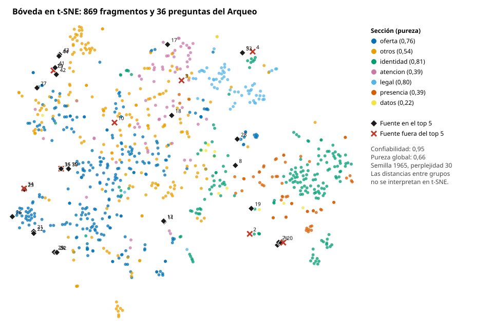

# Proyección t-SNE de la Bóveda

Vista de los embeddings de la Bóveda en dos dimensiones, con las 36 preguntas
evaluables del Arqueo encima. Complementa las métricas de `docs/ARQUEO.md`
(hit@5, recall@10 y nDCG@10): las métricas dicen **cuánto** falla la búsqueda y
esta vista ayuda a explicar **por qué**.



Cada punto es un fragmento del índice, coloreado por su sección. Los rombos
negros son preguntas cuya fuente apareció en el top 5 con los pesos por defecto
(0,6 vectorial y 0,4 BM25); las cruces rojas, las que no. El número junto a cada
marca es el id de la pregunta en `config/evaluacion/preguntas_fase2.toml`.

## Cómo se genera

```bash
uv run python -m banco_occidente_corpus.arqueo.proyeccion
```

Lee los vectores del índice de Qdrant (los mismos que consulta el recuperador),
vectoriza las preguntas con el mismo modelo local de Ollama y ajusta un t-SNE con
distancia coseno, inicio PCA, perplejidad 30 y semilla 1965. No llama a DeepSeek.
Escribe la figura en `docs/img/proyeccion_tsne.svg` y las cifras en
`data/evaluacion/proyeccion.json`.

t-SNE deforma las distancias globales: la separación entre dos grupos y el
tamaño de cada nube no significan nada. Por eso las cifras de esta lectura se
calculan en el espacio original de 768 dimensiones, no en el plano.

## Cifras

| Medida | Valor | Qué dice |
|---|---:|---|
| Confiabilidad (*trustworthiness*, 10 vecinos) | 0,95 | El plano respeta los vecindarios originales: los grupos que se ven existen. |
| Pureza global de vecindario | 0,66 | De los 10 vecinos más cercanos de un fragmento, dos de cada tres son de su sección. Al azar, con estos tamaños, sería cerca de 0,22. |
| Preguntas con la fuente fuera del top 5 | 9 de 36 | Las mismas del Arqueo: hit@5 de 0,75 (27 de 36). |
| Fallos que caen junto a otra sección | 5 de 9 | La pregunta queda más cerca de otra sección que de la de su fuente. |

Pureza por sección (proporción de los 10 vecinos que son de la misma sección):

| Sección | Fragmentos | Pureza |
|---|---:|---:|
| identidad | 180 | 0,81 |
| legal | 60 | 0,80 |
| oferta | 279 | 0,76 |
| otros | 214 | 0,54 |
| presencia | 60 | 0,39 |
| atención | 63 | 0,39 |
| datos | 13 | 0,22 |

## Lectura de los grupos

- **Identidad, legal y oferta forman grupos propios.** Tienen vocabulario
  distintivo (historia y gobierno del banco; reglamentos y contratos; productos
  con sus condiciones), y la búsqueda las encuentra bien.
- **Atención y presencia se mezclan con todo.** Teléfonos, oficinas, canales y
  horarios aparecen en casi todas las páginas del sitio, así que esos fragmentos
  quedan rodeados de fragmentos de otras secciones. Es donde el recuperador más
  se confunde.
- **«Otros» es un cajón amplio.** Junta 214 fragmentos de PDF, guías y
  educación financiera, con pureza media. Sus textos son largos y generales, y
  por eso atraen preguntas que buscaban otra página.
- **Datos son solo 13 fragmentos** y casi no tienen vecinos propios; su pureza
  baja dice más del tamaño de la sección que de su contenido.

## Lectura de los fallos

«Puesto» es la posición del mejor fragmento de la fuente esperada si se ordena
toda la Bóveda solo por coseno con la pregunta.

| P | Pregunta | Cae junto a | Puesto | Qué lo explica |
|---:|---|---|---:|---|
| 16 | ¿Ofrece crédito de vehículo? | oferta (página de inicio) | 6 | Casi acierto: la portada menciona el crédito de vehículo y le gana a las tres páginas del producto. |
| 34 | ¿Y cuánto cubren en Europa? (seguimiento) | oferta (asistencia de viajes) | 7 | Casi acierto y ruta T: la respuesta real sale del Tablero, no de la Bóveda. |
| 3 | ¿Cuál es la línea de atención telefónica? | otros (guía de uso de una tarjeta, PDF) | 9 | Casi acierto: un PDF de producto, que probablemente también trae teléfonos de contacto, le gana a la página de la línea de servicio. |
| 29 | ¿Y cuál es su cuota de manejo? (seguimiento) | otros (guía de uso de una tarjeta, PDF) | 11 | La guía de una tarjeta concreta le gana al catálogo de tarjetas. |
| 13 | ¿Qué tarjetas de crédito ofrece y cuál es su cuota de manejo? | otros (guía de uso de una tarjeta, PDF) | 12 | El mismo caso: un documento específico le gana a la página general. |
| 4 | ¿Cómo presento una petición, queja o reclamo? | identidad (Defensor del Consumidor Financiero) | 12 | La página del Defensor también trata quejas: es una fuente razonable que la etiqueta no cuenta. |
| 2 | ¿Dónde hay una oficina en Cali? | identidad (Nuestro banco) | 16 | La fuente etiquetada es la página de inversionistas, que no es donde alguien buscaría una oficina: vale la pena revisar esa etiqueta. |
| 10 | ¿Qué tipos de cuentas de ahorro ofrece? | otros (educación financiera) | 56 | Brecha de vocabulario: los textos educativos sobre el ahorro se parecen más a la pregunta que la página del producto. |
| 20 | ¿Cuáles son las noticias recientes del banco? | presencia (información para inversionistas) | 102 | «Recientes» es una idea de fecha, no de significado. Cada noticia habla de un hecho concreto y ninguna se parece a la pregunta genérica. |

Se agrupan en cuatro causas:

1. **Casi aciertos (P16, P34 y P3).** La fuente está entre los 10 primeros. Por
   eso recall@10 (0,82) es más alto que hit@5 (0,75).
2. **Documentos específicos que le ganan a la página general (P13, P29 y P3).**
   Las guías en PDF de una tarjeta repiten las palabras de la pregunta. La
   respuesta puede ser útil, pero no es la fuente que espera la evaluación.
3. **Etiquetas discutibles (P2 y P4).** La pregunta cae junto a una fuente que
   también la responde. Son candidatas a revisar en el banco de preguntas antes
   de leerlas como fallos del recuperador.
4. **Preguntas que la similitud no puede resolver (P10 y P20).** P20 necesita un
   filtro por tipo y fecha (noticias recientes), no una búsqueda por significado.
   P10 pide un catálogo, y los textos educativos sobre el ahorro se parecen más a
   la pregunta que la ficha del producto.

## Qué haríamos con esto

- Filtrar por metadatos (tipo `noticia` y fecha) cuando la pregunta pide
  novedades, en vez de buscar por similitud.
- Bajar el peso de los PDF de un solo producto cuando la pregunta es general
  («qué tarjetas ofrece»).
- Revisar las fuentes esperadas de P2 y P4 en el banco de preguntas.

## Límites

- Es una sola corrida con semilla fija. Otra semilla cambia la forma del dibujo,
  pero no las cifras de pureza ni los puestos, que se calculan en el espacio
  original.
- Las preguntas se vectorizan con el prefijo de consulta y los fragmentos con el
  de documento, como en la búsqueda real. Por eso las preguntas pueden quedar en
  el borde de los grupos y no en su centro.
- El puesto por coseno mide solo la parte vectorial. El Arqueo usa la búsqueda
  híbrida, que también suma BM25.
- Las secciones son las del corpus y «otros» agrupa contenido variado: una
  pureza media ahí no quiere decir que el contenido esté mal clasificado.
